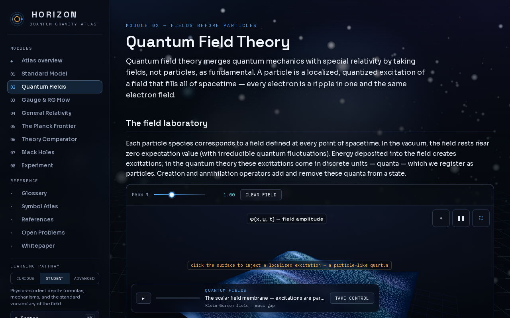
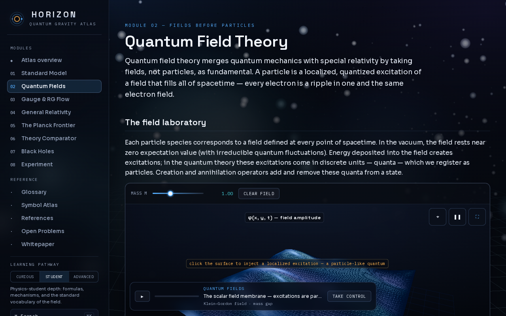
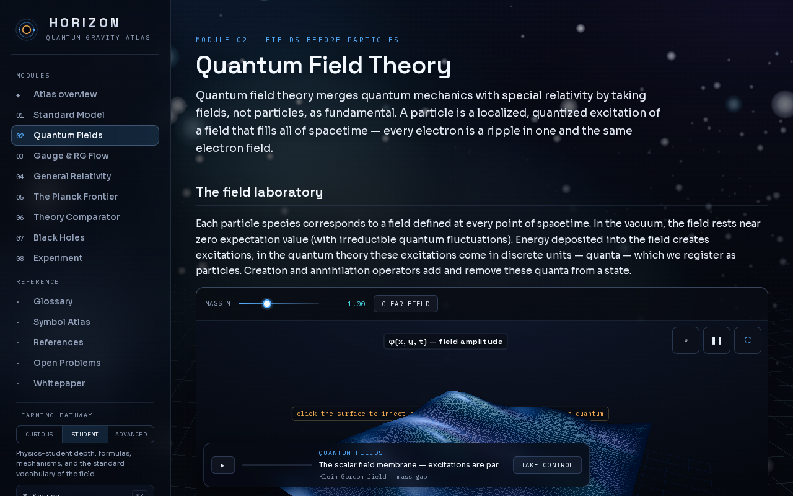
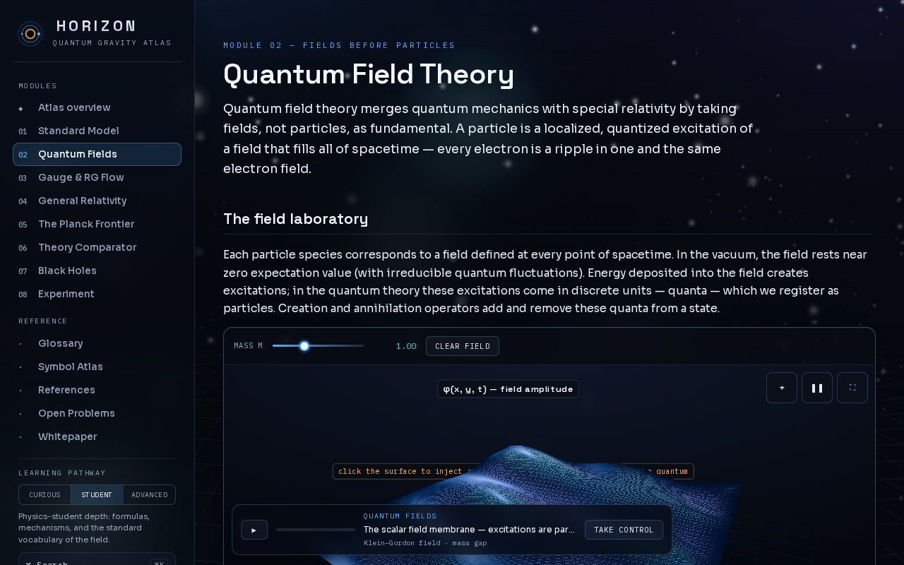
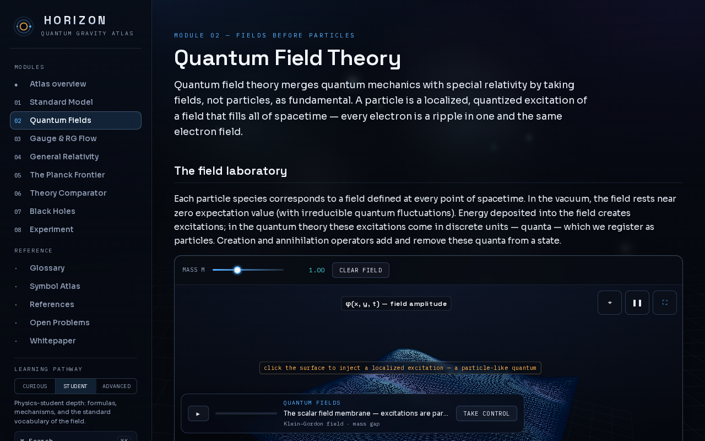
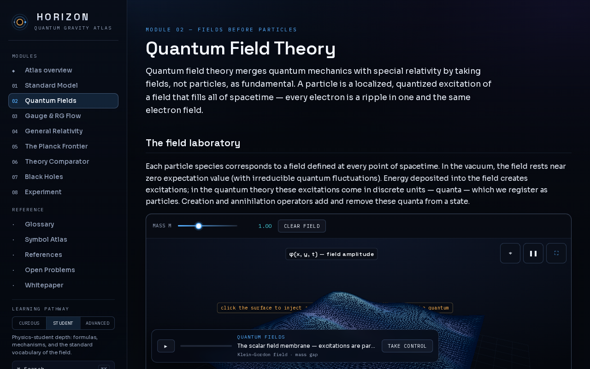
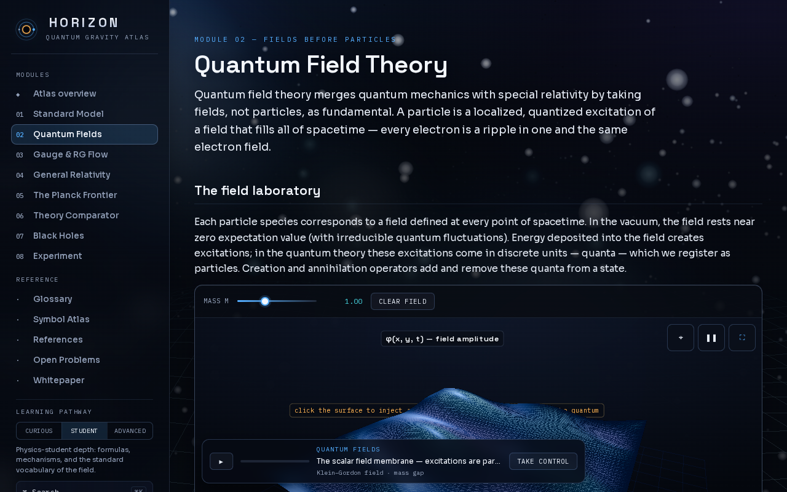
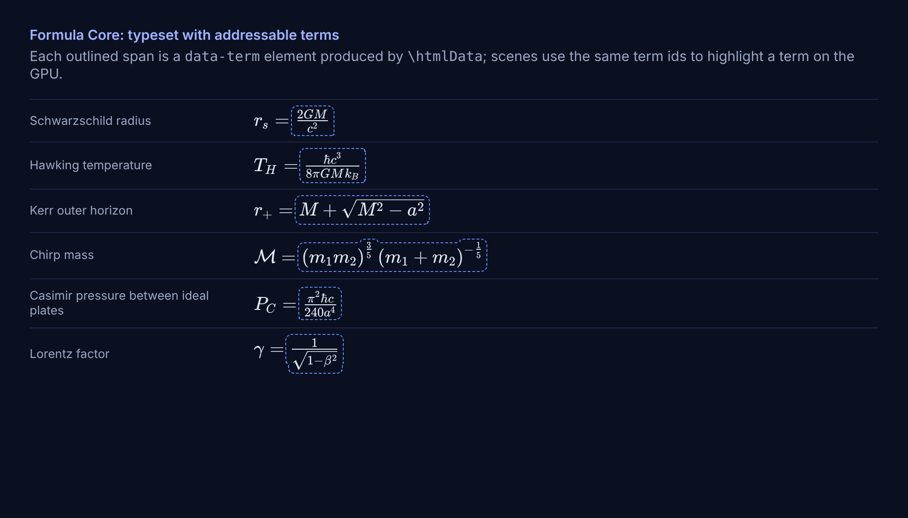

# S03 + S04: what changed on screen

**Short version.** Nothing in the default atlas looks different. S03 adds a formula engine that no screen uses yet; S04 adds an opt-in shared GPU stage that is **off by default**. This page shows what each piece looks like when it is exercised, and the one place a new visual element exists (the frozen-frame placeholder under a tight WebGL2 budget).

All screenshots are in [`img/s04/`](img/s04/), produced by `node scripts/docs/capture-s04-visuals.mjs` (QFT view, `?seed=42`, 1280 × 800, reduced motion so every scene settles on one frame, SwiftShader software rasteriser). The raw numbers behind them are in [`img/s04/report.json`](img/s04/report.json).

## 1. Default look: unchanged

Stage off (the default) and stage on, same page, WebGL2:

| Stage off | Stage off, second load (control) | Stage on (`stage: "shared"`) |
|---|---|---|
|  |  |  |

Same chrome, same scene, same overlays. The pixels are **not** byte-identical, and they cannot be: the backdrop starfield is generated with an unseeded `Math.random` (existing code in `js/atlas-stage.jsx`), so two loads of the *same* configuration already differ. The control column measures that floor:

| Comparison (this capture run) | Mean absolute channel difference (0–255) | Share of pixels differing by > 8 |
|---|---|---|
| stage off vs stage off (control) | 3.37 | 14.5 % |
| stage off vs stage on | 4.35 | 18.3 % |

Three capture runs gave 4.17 / 3.37 / 5.65 for the control and 3.32 / 4.35 / 5.55 for off vs on: which pair is larger changes from run to run, and both sit in the same 3–6 band. So the stage-on page differs from a stage-off page about as much as two stage-off pages differ from each other; this measurement cannot show a difference caused by the stage, and it does not claim byte-identical output.

## 2. The one new visual element: frozen-frame placeholder (WebGL2, tight budget)

A WebGL context belongs to one canvas, so on WebGL2 the shared stage keeps **at most 4 live contexts** (`QGA_RENDER_OPTIONS.maxContexts`). When a scene needs a context and none is free, the scene that was visible longest ago snapshots its last frame, releases its renderer, and shows that snapshot as an image until it is seen again.

With `maxContexts: 1` (the extreme, to make it visible on one screen) the Atlas backdrop gives its context to the field membrane scene and keeps showing its last frame:



What to look for: the backdrop (stars, nebulae) is still there, now an `` instead of a canvas. The scene in front is live. In normal use (`maxContexts` 4, three pilot scenes) nothing is displaced and no placeholder is ever shown; a scene that starts below the fold is *parked* (no context, plain dark stage) until it scrolls into view.

## 3. WebGPU: one renderer, one canvas target per scene

With WebGPU the stage renders every pilot canvas from a single `WebGPURenderer`. Same page, own renderers per scene (left) vs shared stage (right):

| WebGPU, stage off | WebGPU, stage on |
|---|---|
|  |  |

The WebGPU backdrop is darker and sparser than the WebGL2 one in both columns; that is how the existing WebGPU path renders it, not an effect of the stage. Renderer counts for this page (`report.json`): stage off **4** live renderers, stage on **2** (the three pilots share one; the collision-lab scene is not a pilot yet). After S05 the page needs 1.

## 4. WebGL2 with the stage on (live frame)



Three pilots on the pool (backdrop, field membrane, Fourier vacuum lab below the fold) plus the unmigrated collision scene: 4 live contexts, at the budget.

## 5. Formula Core: typeset terms

S03's formulas typeset through KaTeX with each named term wrapped in `\htmlData{term=<id>}`. The outlines below are drawn by this page's stylesheet around the `data-term` elements the engine emits; the atlas itself draws no outline. Later prompts use the same ids to highlight a term in the equation and in the GPU image at once.



The six formulas shown are evaluated in JavaScript, in float32, and in TSL from one definition (S03 evidence: GPU readback within 5.7e-7 of the float32 reference).

## 6. Behaviour you cannot see in a still

| Behaviour | How it is checked |
|---|---|
| A paused (static) scene draws **0 frames** while idle; the stage loop stops | `qa/specs/shared-stage.spec.mjs` counts frames over 2 s, WebGL2 and WebGPU |
| Unseen scenes are parked and restored on demand; budget 1 does not deadlock | `shared-stage.spec.mjs` (budgets 4, 2 and 1) |
| Snapshot thumbnails and captures are non-blank without `preserveDrawingBuffer` | `shared-stage.spec.mjs` captures; `sceneHandle.capture()` |
| WebGPU GPU time is measured and fed to the quality governor | `shared-stage.spec.mjs` (WebGPU case), `test/quality-governor.test.mjs` |

## 7. How to turn it on

```js
// before the page scripts run
window.QGA_RENDER_OPTIONS = { stage: "shared" };            // pilots only
window.QGA_RENDER_OPTIONS = { stage: "shared", maxContexts: 2 }; // tighter WebGL2 budget
```

Off by default in S04; S05 migrates every scene and flips the default.
