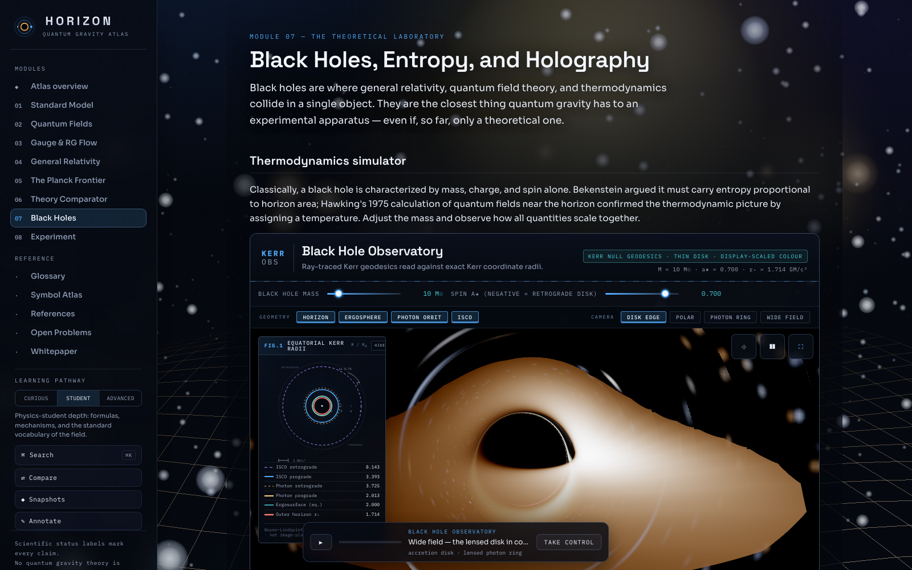
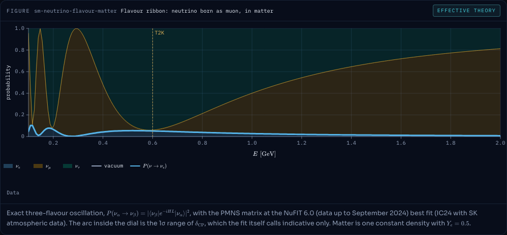
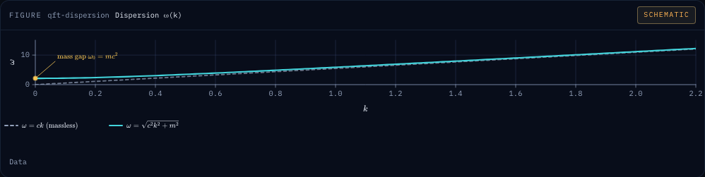
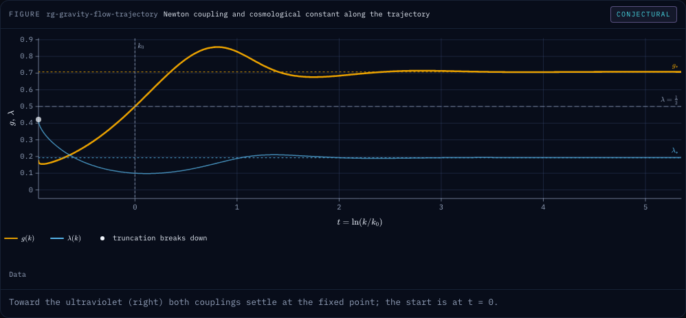
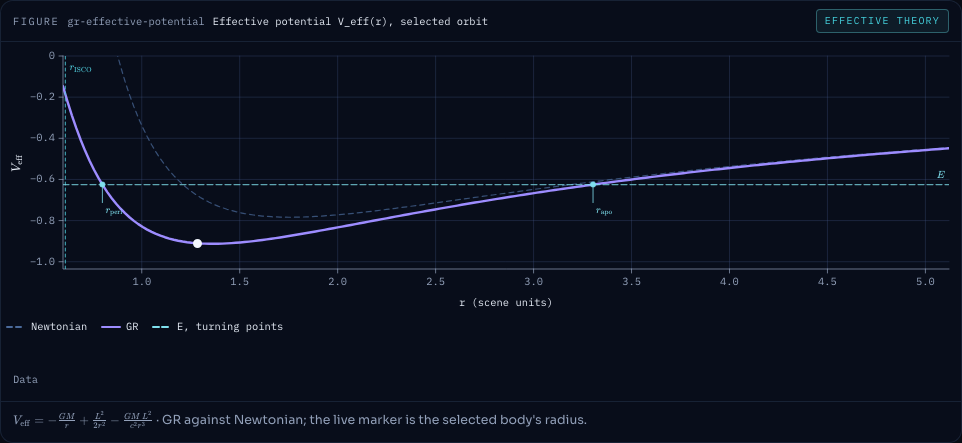
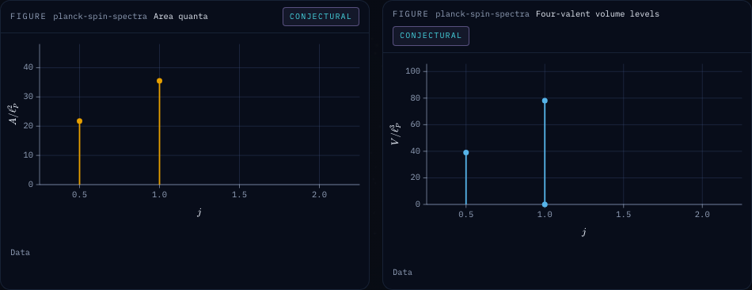
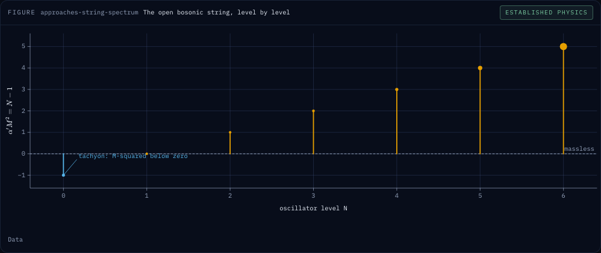
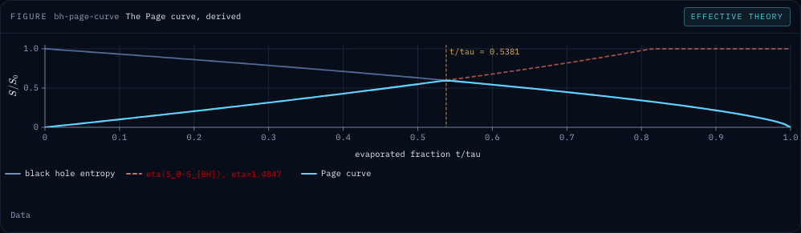
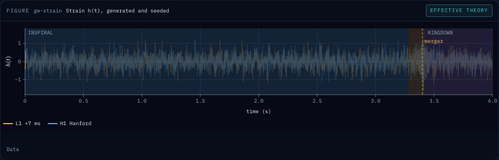
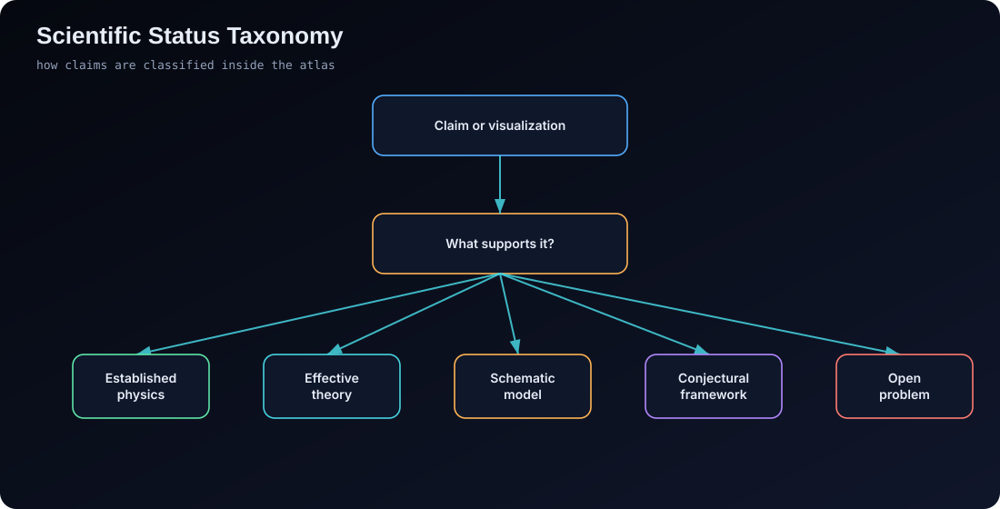

<!-- markdownlint-disable MD033 MD041 MD034 MD013 MD024 -->

<div align="center">



<br/><br/>

<p>
  <a href="https://mustafaras.github.io/horizon-quantum-gravity-atlas/"></a>
  <a href="https://github.com/mustafaras/horizon-quantum-gravity-atlas/actions/workflows/quality.yml"></a>
  <a href="#run-locally"></a>
  <a href="#technical-architecture"></a>
  <a href="#scientific-status-system"></a>
  <a href="#license"></a>
</p>

<h1 align="center">HORIZON — Quantum Gravity Atlas</h1>

<h3 align="center">A cinematic, equation-aware, scientifically cautious atlas of the road from quantum fields to dynamical spacetime.</h3>

<p align="center">
  <strong>
    Standard Model · Quantum Field Theory · Gauge Symmetry · Renormalization · General Relativity · Planck Scale ·
    Quantum Gravity Programs · Black Holes · Holography · Collider and Gravitational-Wave Constraints
  </strong>
</p>

<p align="center">
  <a href="#the-eight-chapters">Chapters</a>
  ·
  <a href="#run-locally">Run Locally</a>
  ·
  <a href="#documentation">Documentation</a>
  ·
  <a href="#citation">Cite</a>
  ·
  <a href="https://mustafaras.github.io/horizon-quantum-gravity-atlas/?view=paper">Whitepaper</a>
</p>

</div>

---

## Scientific Position

**HORIZON** is not a claim that quantum gravity has been solved.

It is an interactive map of why the problem exists.

For the formal treatment — the epistemic labeling system, the chain of reasoning, the design methodology, and the verification infrastructure — read the companion whitepaper **inside the atlas** at [`?view=paper`](https://mustafaras.github.io/horizon-quantum-gravity-atlas/?view=paper), where every formulation is typeset live with KaTeX. A plain-Markdown mirror is kept at **[docs/whitepaper.md](docs/whitepaper.md)** for citation and offline reading.

It starts from experimentally established physics.

It moves through the formal machinery of quantum field theory and general relativity.

It shows where those frameworks conflict.

It then compares the major research programs without declaring a winner.

The central rule of the project is simple:

> A visualization may be cinematic, but the epistemic status of the physics must remain explicit.

No complete theory of quantum gravity is experimentally confirmed.

Hawking radiation is theoretically compelling but not directly observed.

String theory, loop quantum gravity, asymptotic safety, causal sets, and holography are serious research programs, not established descriptions of nature.

Black holes are used as theoretical laboratories, not as solved experimental apparatuses.

The app therefore labels claims as **established physics**, **effective theory**, **schematic model**, **conjectural framework**, or **open problem**.

### What it is

- A static web application: eight chapters from the Standard Model to experimental constraints, with live, seeded
  simulations and figures computed by tested pure modules (`js/science/`, `js/formula/`).
- Every figure carries a status label and a registered provenance entry; every equation on screen comes from one
  definition in Formula Core.
- Reproducible: the URL encodes the state, generated data is seeded, and every screenshot is backed by a capture manifest.

### What it is not

- Not a solution to quantum gravity, and not a ranking of the programs that attempt one.
- Not an observation: the black-hole image is a numerical ray trace with display-scaled colour, the Planck foam and the
  collider event display are schematic, and the bundled GWOSC fixture is synthetic.
- Not a research code: the simulations are pedagogical instruments with stated limits. The limits are listed in the
  [limitations registry](docs/guide/appendix-k-z.md#appendix-p--scientific-limitations-registry).

---

## The Eight Chapters

Each chapter opens with a cover rendered from the chapter's own science at a fixed seed by `scripts/render-covers.mjs`,
with a provenance sidecar beside it in [`docs/covers/`](docs/covers/). Every cover is a screenshot of the module's own
computed figure; the link under it opens that state live.

<table>
<tr>
<td width="50%">

<br/>
<sub><strong>01 · Standard Model</strong> — PMNS flavour oscillation. <a href="https://mustafaras.github.io/horizon-quantum-gravity-atlas/?view=sm&seed=42">Open live</a></sub>
</td>
<td width="50%">

<br/>
<sub><strong>02 · Quantum Field Theory</strong> — lattice dispersion relation. <a href="https://mustafaras.github.io/horizon-quantum-gravity-atlas/?view=qft&seed=42">Open live</a></sub>
</td>
</tr>
<tr>
<td width="50%">

<br/>
<sub><strong>03 · Gauge Symmetry & RG Flow</strong> — gravity-flow trajectory. <a href="https://mustafaras.github.io/horizon-quantum-gravity-atlas/?view=rg&seed=42">Open live</a></sub>
</td>
<td width="50%">

<br/>
<sub><strong>04 · General Relativity</strong> — the effective potential of a geodesic. <a href="https://mustafaras.github.io/horizon-quantum-gravity-atlas/?view=gr&seed=42">Open live</a></sub>
</td>
</tr>
<tr>
<td width="50%">

<br/>
<sub><strong>05 · Planck Frontier</strong> — the discrete area and volume spectra of loop quantum gravity. <a href="https://mustafaras.github.io/horizon-quantum-gravity-atlas/?view=planck&seed=42">Open live</a></sub>
</td>
<td width="50%">

<br/>
<sub><strong>06 · Theory Comparator</strong> — the string mass spectrum. <a href="https://mustafaras.github.io/horizon-quantum-gravity-atlas/?view=approaches&seed=42">Open live</a></sub>
</td>
</tr>
<tr>
<td width="50%">

<br/>
<sub><strong>07 · Black Holes</strong> — the Page curve. <a href="https://mustafaras.github.io/horizon-quantum-gravity-atlas/?view=bh&seed=42">Open live</a></sub>
</td>
<td width="50%">

<br/>
<sub><strong>08 · Experiment</strong> — the GW150914 strain. <a href="https://mustafaras.github.io/horizon-quantum-gravity-atlas/?view=exp&seed=42">Open live</a></sub>
</td>
</tr>
</table>

The full gallery of 26 captured screenshots, with the scientific caveat of each, is the
[Visual Atlas](docs/guide/visual-atlas.md).

### Module Matrix

| # | Module | Core scientific role | Visual system | Epistemic emphasis |
|---|---|---|---|---|
| 01 | Standard Model | Particle content and gauge architecture | 3D particle map and analytical atlas | established physics with known gaps |
| 02 | Quantum Field Theory | Fields, quanta, amplitudes, propagators | GPU φ⁴ lattice field laboratory and Feynman collision lab | established formalism with pedagogical simplification |
| 03 | Gauge Symmetry & RG Flow | Local symmetry, scale dependence, and fixed-point stability | synchronized running-coupling / β-function flow chamber; two-loop running of the three Standard-Model gauge couplings to the Planck scale | one-loop QED/QCD with domain limits; two-loop Standard-Model couplings without Yukawa terms; pedagogical and conjectural presets (the MSSM above $M_{\mathrm{SUSY}}$ included) explicitly separated |
| 04 | General Relativity | Local causal structure and gravity as curved spacetime | Minkowski causal laboratory, deformable geometry, geodesics, lensing rays | exact flat-spacetime SR foundation plus established classical GR |
| 05 | Planck Frontier | Why perturbative quantum gravity fails | scale ladder and speculative foam visualization | established obstruction, speculative visualization |
| 06 | Theory Comparator | Candidate quantum-gravity programs | 3D theory constellation and comparator | conjectural frameworks |
| 07 | Black Holes | Entropy, horizons, Hawking radiation, holography | raymarched black hole, Page curve, holography | semiclassical landmarks and open paradoxes |
| 08 | Experiment | Collider, gravitational-wave, cosmological constraints | detector event, resonance histogram, binary inspiral | indirect constraints and null results |

---

## Scientific Status System

<p align="center">
  
</p>

### Label Semantics

| Label | Meaning | Examples in HORIZON |
|---|---|---|
| Established physics | experimentally tested or standard within accepted theory | Standard Model fields, Einstein field equations, gravitational waves |
| Effective theory | valid in a controlled regime below a cutoff | low-energy quantum gravity EFT |
| Schematic | visual or pedagogical model, not a literal observation | spacetime grid, collider event display, Planck foam rendering |
| Conjectural | researched but not experimentally confirmed | string theory, LQG, asymptotic safety, holographic universality |
| Open problem | unresolved conceptual or empirical issue | information paradox, cosmological constant, problem of time |

---

## Run Locally

Use a local HTTP server.

Do not open `index.html` directly with `file://`.

The app loads scripts as separate files, so an HTTP server is the reliable route.

```bash
npm start
```

Alternative:

```bash
npx serve .
```

Alternative:

```bash
python -m http.server 8000
```

Then open:

```text
http://127.0.0.1:8000/
```

There is no build step and no backend. React 18, Three.js 0.186.1, KaTeX and the web fonts are self-hosted under
`vendor/`, so the atlas has no runtime third-party network dependency. The live deployment is
[GitHub Pages](https://mustafaras.github.io/horizon-quantum-gravity-atlas/).

To run the checks:

```bash
npm ci
npm test            # node:test suites for the science, formula, provenance, ledger and citation
npm run validate    # repository rules, internal links, formula and provenance audits
```

---

## Documentation

| Where | What |
|---|---|
| [docs/guide/](docs/guide/README.md) | Visual Atlas, architecture, development and quality gates, design principles, the A–Z appendix |
| [docs/science/](docs/science/mathematical-formulations.md) | mathematical formulations, module notes, references, and the Kerr and GR science specifications |
| [docs/whitepaper.md](docs/whitepaper.md) | the companion paper, also in the app at `?view=paper` |
| [docs/superpowers/ledger/](docs/superpowers/ledger/README.md) | the project ledger: every change with its evidence, decisions and dated log |

### Moved sections

The README used to carry every section below in full. They now live in the guide; the headings stay so that existing
links to them still land somewhere useful.

#### Live Access

→ [docs/guide/development.md](docs/guide/development.md#live-access)

#### Social Preview and Install Metadata

→ [docs/guide/development.md](docs/guide/development.md#social-preview-and-install-metadata)

#### Visual Atlas

→ [docs/guide/visual-atlas.md](docs/guide/visual-atlas.md)

#### Scientific Thesis

→ [docs/guide/design-principles.md](docs/guide/design-principles.md#scientific-thesis)

#### Design Principles

→ [docs/guide/design-principles.md](docs/guide/design-principles.md#design-principles)

#### Architecture Preview

→ [docs/guide/architecture.md](docs/guide/architecture.md#architecture-preview)

#### Scientific Validity Matrix

→ [docs/science/module-notes.md](docs/science/module-notes.md#scientific-validity-matrix)

#### Mathematical Formulations

→ [docs/science/mathematical-formulations.md](docs/science/mathematical-formulations.md)

#### Static Diagram Pack

→ [docs/guide/visual-atlas.md](docs/guide/visual-atlas.md#static-diagram-pack)

#### Feature Inventory

→ [docs/guide/architecture.md](docs/guide/architecture.md#feature-inventory)

#### Technical Architecture

→ [docs/guide/architecture.md](docs/guide/architecture.md#technical-architecture)

#### Quality Gates

→ [docs/guide/development.md](docs/guide/development.md#quality-gates)

#### Reproducible sharing and data modes

→ [docs/guide/development.md](docs/guide/development.md#reproducible-sharing-and-data-modes)

#### Screenshot Reproduction Guide

→ [docs/guide/development.md](docs/guide/development.md#screenshot-reproduction-guide)

#### Scientific Module Notes

→ [docs/science/module-notes.md](docs/science/module-notes.md)

#### Academic Integrity Notes

→ [docs/science/module-notes.md](docs/science/module-notes.md#academic-integrity-notes)

#### User Experience Model

→ [docs/guide/architecture.md](docs/guide/architecture.md#user-experience-model)

#### Accessibility and Responsiveness

→ [docs/guide/development.md](docs/guide/development.md#accessibility-and-responsiveness)

#### Performance Notes

→ [docs/guide/development.md](docs/guide/development.md#performance-notes)

#### Deployment

→ [docs/guide/development.md](docs/guide/development.md#deployment)

#### Development Notes

→ [docs/guide/development.md](docs/guide/development.md#development-notes)

#### References

→ [docs/science/references.md](docs/science/references.md)

#### Extended Academic Appendix

→ [docs/guide/appendix-a-j.md](docs/guide/appendix-a-j.md) and [docs/guide/appendix-k-z.md](docs/guide/appendix-k-z.md)

---

## Roadmap

The roadmap and the change history live in one place: the project ledger,
[`docs/superpowers/ledger/ledger.json`](docs/superpowers/ledger/ledger.json). It records, for each of the thirty-six
prompts of the [v2 prompt pack](docs/superpowers/plans/horizon-v2/README.md), its status, the evidence it was accepted
on (test counts, measurements, screenshots), the decisions taken on the way, and a dated log. Its
[README](docs/superpowers/ledger/README.md) explains how to read it, and `npm test` rejects an inconsistent ledger.

---

## Citation

This repository carries a [CITATION.cff](./CITATION.cff) (CFF 1.2.0, validated against the official schema). GitHub surfaces it automatically as a "Cite this repository" button, and tools like `cffconvert` can convert it to BibTeX, RIS, or EndNote. The file deliberately contains no DOI or identifier block: those fields stay empty until a genuinely registered identifier exists.

For archiving, [`.zenodo.json`](./.zenodo.json) carries the same title, author, abstract, keywords, licence and version for Zenodo's GitHub release integration (which reads it in preference to `CITATION.cff`). It also carries no DOI: Zenodo mints one when the maintainer publishes a release, and only then is it added here. `npm test` keeps the two files in agreement.

Suggested software citation:

```bibtex
@software{horizon_quantum_gravity_atlas_2026,
  title        = {HORIZON: Quantum Gravity Atlas},
  author       = {{\c{S}}ahin, Mustafa Ra{\c{s}}it},
  year         = {2026},
  license      = {MIT},
  note         = {Interactive static-web atlas of quantum gravity concepts, black-hole thermodynamics, and experimental constraints}
}
```

---

## License

[MIT](./LICENSE)

Code and educational content may be used, studied, and adapted with attribution.

---

<div align="center">

<br/>

<strong>HORIZON is a scientific interface for the edge of known physics.</strong>

<br/>

<sub>
Visual scenes are pedagogical instruments.
Status labels are part of the scientific argument.
No complete quantum-gravity theory is presented as experimentally confirmed.
</sub>

<br/><br/>


</div>
