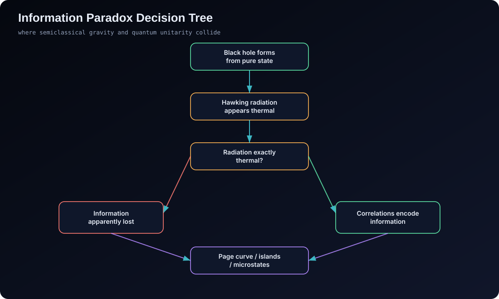

# Extended Academic Appendix — A to J

> Moved from the README in S35. Appendices K to Z are in [appendix-k-z.md](appendix-k-z.md). Back to the
> [README](../../README.md) · [guide index](README.md).

This appendix turns the README into a research-style dossier.

It is written for readers who want more than a gallery.

It provides symbol inventory, formal constraints, theory comparison, black-hole thermodynamic bookkeeping, and experimental interpretation rules.

## Appendix A — Core Symbol Table

| Symbol | Domain | Meaning | Module |
|---|---|---|---|
| $c$ | constant | speed of light in vacuum | all |
| $\hbar$ | constant | reduced Planck constant | QFT, Planck, black holes |
| $G$ | constant | Newton gravitational constant | GR, Planck, black holes |
| $k_B$ | constant | Boltzmann constant | black-hole thermodynamics |
| $g_{\mu\nu}$ | tensor | spacetime metric | GR |
| $\eta_{\mu\nu}$ | tensor | Minkowski metric | QFT, perturbative gravity |
| $h_{\mu\nu}$ | tensor field | metric perturbation / graviton field | Planck frontier |
| $R_{\mu\nu}$ | tensor | Ricci curvature | GR |
| $R$ | scalar | Ricci scalar | GR |
| $G_{\mu\nu}$ | tensor | Einstein tensor | GR |
| $T_{\mu\nu}$ | tensor | stress-energy tensor | GR |
| $\Lambda$ | scalar | cosmological constant | GR, open problems |
| $\Gamma^\mu_{\alpha\beta}$ | connection | Christoffel symbols | GR |
| $\phi$ | field | scalar field | QFT |
| $\psi$ | field | spinor field | Standard Model, QFT |
| $A_\mu$ | field | gauge potential | gauge theory |
| $F_{\mu\nu}$ | tensor | gauge field strength | gauge theory |
| $g_s$ | coupling | strong coupling | Standard Model |
| $g$ | coupling | weak coupling | Standard Model |
| $g'$ | coupling | hypercharge coupling | Standard Model |
| $\alpha$ | coupling | fine-structure constant or generic coupling | QFT |
| $\beta(g)$ | function | renormalization-group beta function | RG |
| $E_P$ | scale | Planck energy | Planck frontier |
| $\ell_P$ | scale | Planck length | Planck frontier |
| $m_P$ | scale | Planck mass | Planck frontier |
| $t_P$ | scale | Planck time | Planck frontier |
| $r_s$ | length | Schwarzschild radius | black holes |
| $r_+$ | length | Kerr outer horizon radius | black holes |
| $a_\star$ | scalar | dimensionless Kerr spin parameter | black holes |
| $A$ | area | horizon area | black holes |
| $S_{BH}$ | entropy | Bekenstein-Hawking entropy | black holes |
| $T_H$ | temperature | Hawking temperature | black holes |
| $Q_{ij}$ | tensor | mass quadrupole tensor | experiments |
| $s,t,u$ | invariants | Mandelstam variables | QFT |
| $\Gamma_Z$ | width | $Z^0$ decay width | experiments |
| $M_Z$ | mass | $Z^0$ mass | experiments |

## Appendix B — Dimensional Analysis Backbone

Dimensional analysis is one of the cleanest routes into the quantum-gravity problem.

In natural units where $\hbar=c=1$, action is dimensionless.

The Lagrangian density in four spacetime dimensions has mass dimension $4$.

A scalar field has mass dimension $1$.

A Dirac spinor has mass dimension $3/2$.

A gauge field has mass dimension $1$.

The Yang-Mills coupling is dimensionless.

Newton's constant has mass dimension $-2$.

Therefore gravitational perturbation theory contains a coupling that grows with energy.

The schematic expansion parameter is:

```math
\kappa E \sim \frac{E}{E_P}
```

At low energy this is small.

At Planck energy this is order unity.

Above that scale perturbation theory loses the hierarchy that made it predictive.

This is why the atlas does not frame quantum gravity as merely "hard mathematics."

It is structurally different from renormalizable gauge theory.

## Appendix C — Effective Field Theory Logic

Effective field theory does not mean "fake theory."

It means "valid below a scale."

The low-energy action contains all operators compatible with the symmetries.

Operators are ordered by relevance under scaling.

For gravity, the expansion is controlled by curvature over the Planck scale.

The leading term is the Einstein-Hilbert action.

The next terms are higher-curvature corrections.

The coefficients encode ultraviolet physics not resolved by the EFT.

The EFT is predictive at low energy because only finitely many terms matter at a given precision.

The EFT is incomplete because it cannot determine the ultraviolet completion.

This is the distinction the README preserves:

- low-energy quantum gravity: controlled effective theory;
- Planck-scale quantum gravity: open problem;
- candidate UV completions: conjectural frameworks.

## Appendix D — Quantum-Gravity Program Comparison

| Program | Fundamental move | Strength | Main unresolved issue | Status |
|---|---|---|---|---|
| String theory | replace point particles with one-dimensional extended objects | perturbative finiteness and graviton mode | vacuum selection and low-energy predictions | conjectural |
| Loop quantum gravity | quantize geometry using holonomies and fluxes | background independence | dynamics and semiclassical limit | conjectural |
| Asymptotic safety | seek interacting UV fixed point | possible nonperturbative renormalizability | truncation control and empirical signatures | conjectural |
| EFT gravity | quantize GR below the Planck scale | controlled low-energy predictions | no UV completion | effective |
| Holography | encode bulk gravity in boundary quantum theory | black-hole information and entanglement geometry | special backgrounds and cosmology | conjectural |
| Causal sets | replace continuum with locally finite order | built-in causal discreteness | continuum recovery and dynamics | conjectural |
| Causal dynamical triangulations | sum over causal geometries | numerical continuum phases | matter coupling and analytic control | conjectural |
| Emergent gravity | spacetime/gravity arise from deeper degrees of freedom | reframes geometry and thermodynamics | identifying the underlying system | conjectural |

## Appendix E — Program Evaluation Questions

Every candidate quantum-gravity program is evaluated against the same questions.

1. Does it recover general relativity at macroscopic scales?

2. Does it recover quantum field theory in weakly curved regimes?

3. Does it reproduce black-hole entropy?

4. Does it offer a unitary account of evaporation?

5. Does it define local or relational observables?

6. Does it preserve Lorentz symmetry or explain its apparent low-energy validity?

7. Does it address the cosmological constant problem?

8. Does it make testable predictions?

9. Does it explain singularity resolution?

10. Does it provide a nonperturbative definition?

11. Does it remain mathematically controlled?

12. Does it distinguish background independence from background covariance?

13. Does it define time fundamentally or relationally?

14. Does it include Standard Model matter naturally?

15. Does it explain why the classical limit looks four-dimensional?

The app does not claim any program satisfies all of these.

That is precisely why the comparator exists.

## Appendix F — Black-Hole Derivation Checklist

The black-hole module centers on a compact chain of results.

Start from Schwarzschild geometry:

```math
ds^2 =
-\left(1-\frac{2GM}{c^2r}\right)c^2dt^2
+\left(1-\frac{2GM}{c^2r}\right)^{-1}dr^2
+r^2d\Omega^2
```

The event horizon occurs at:

```math
r = r_s = \frac{2GM}{c^2}
```

The area is:

```math
A = 4\pi r_s^2
```

Substitute $r_s$:

```math
A = 16\pi \frac{G^2M^2}{c^4}
```

The entropy is:

```math
S_{BH}
=
\frac{k_Bc^3A}{4G\hbar}
```

Substitute $A$:

```math
S_{BH}
=
4\pi k_B \frac{GM^2}{\hbar c}
```

The Hawking temperature is:

```math
T_H =
\frac{\hbar c^3}{8\pi GMk_B}
```

Notice the inverse mass scaling.

Larger black holes are colder.

Smaller black holes are hotter.

This implies negative specific heat.

It also makes astrophysical Hawking radiation extremely hard to observe.

## Appendix G — Kerr Quantities Used by the App

The visual black-hole scene is pedagogical.

The readout layer tracks Kerr-inspired quantities.

For dimensionless spin $a_\star$:

```math
0 \le a_\star < 1
```

The outer horizon decreases as spin increases:

```math
r_+ = M + \sqrt{M^2-a^2}
```

In geometric units:

```math
G=c=1
```

The prograde ISCO decreases from $6M$ toward $M$ as the extremal limit is approached.

The ergosphere at the equator occurs at:

```math
r_{\mathrm{ergo}} = 2M
```

Away from the equator the stationary-limit surface is polar-angle dependent:

```math
r_E(\theta) = M + \sqrt{M^2 - a^2\cos^2\theta}
```

which reduces to $2M$ at $\theta = 90^\circ$ and to $r_+$ at the pole. The observatory's live formulation panel prints both values for the current spin.

The visual disk is not a numerical GRMHD simulation.

It is a cinematic ray-bending approximation.

The README makes this explicit to avoid overclaiming.

## Appendix H — Information Paradox Decision Tree

<p align="center">
  
</p>

## Appendix I — Experimental Constraint Taxonomy

| Channel | What is measured | What it constrains | What it does not prove |
|---|---|---|---|
| LHC collisions | high-energy particle events | TeV-scale new physics, extra dimensions, supersymmetry bounds | Planck-scale quantum gravity |
| Resonance searches | invariant-mass peaks | new particles or excluded mass ranges | absence of all UV completions |
| Gravitational waves | strong-field merger waveforms | deviations from GR, dispersion, echoes | direct graviton detection |
| EHT images | black-hole shadow geometry | horizon-scale compact-object structure | Hawking radiation |
| CMB anisotropies | early-universe perturbations | inflationary and cosmological parameters | direct Planck-scale discreteness |
| Lorentz tests | high-energy photon timing and dispersion | Lorentz-violation models | all quantum-gravity models |
| Short-range gravity | deviations from inverse-square law | large extra dimensions, fifth forces | generic quantum gravity |
| Precision clocks | gravitational redshift and equivalence | equivalence-principle violations | complete spacetime quantization |

## Appendix J — Observational Honesty Rules

If a result is measured, name the measurement.

If a result is inferred, name the inference.

If a scene is schematic, label it as schematic.

If a framework is conjectural, label it as conjectural.

If a claim depends on a special background, state the background.

If a scale is inaccessible, state the gap.

If a formula is semiclassical, state which ingredients are classical and which are quantum.

If a visualization simplifies time, geometry, or dynamics, say so.

If a theory recovers a result only in a special case, say so.

If an experiment constrains but does not confirm a model, say so.
