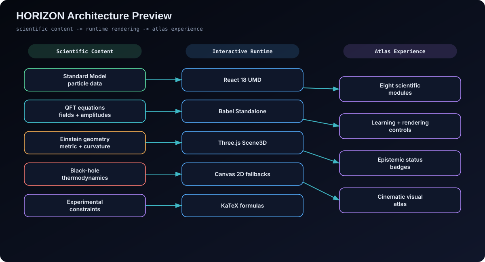
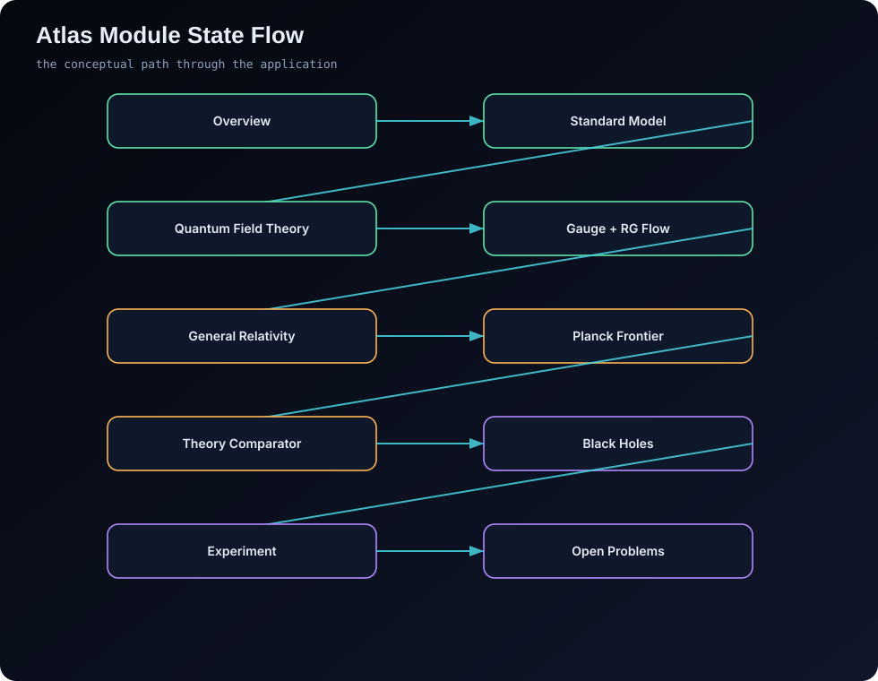
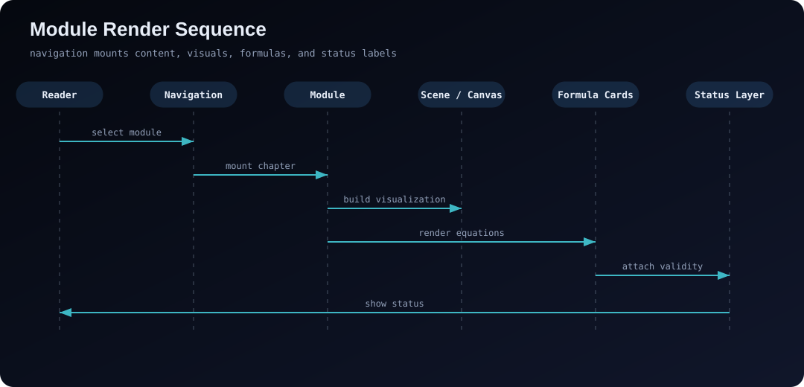
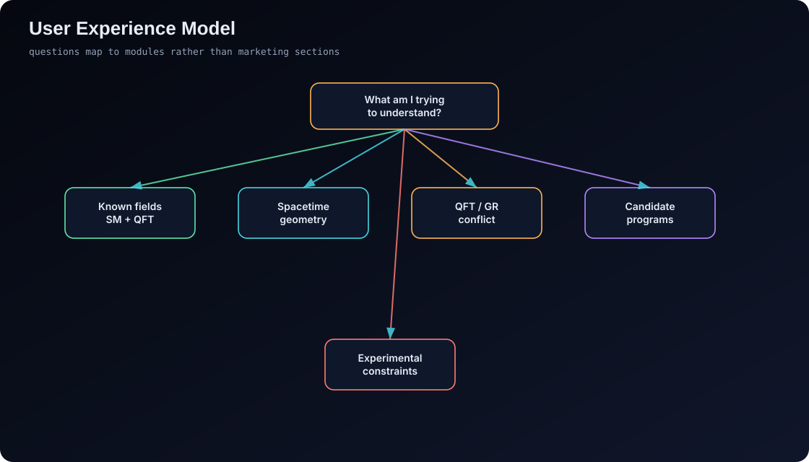

# Architecture

> Moved from the README in S35: Architecture Preview, Feature Inventory, Technical Architecture and the User
> Experience Model. Back to the [README](../../README.md) · [guide index](README.md).

## Architecture Preview

<p align="center">
  
</p>

<p align="center">
  
</p>

<p align="center">
  
</p>

Prompt 00's renderer/science ownership map, lifecycle contract, fallback policy, and current WebGL inventory live in **[docs/render-architecture.md](../render-architecture.md)**.

The Kerr ray-tracing science core — null geodesics, spin-dependent characteristic radii, thin-disk thermodynamics, relativistic frequency shifts, and spectral colour conversion — is specified in **[docs/science/kerr-rendering.md](../science/kerr-rendering.md)**, which separates exact equations from numerical, display, and conjectural approximations and documents the measured drift and convergence bounds. Run `npm run benchmark:kerr` to reproduce the ray count, median integration time, convergence error, and conserved-quantity drift on your own machine. The renderer built on that core — quality budgets, temporal accumulation, image-order tinting, distortion-aware star filtering, focus picking and the documented operation order — is specified in **[docs/science/kerr-observatory.md](../science/kerr-observatory.md)**.

The non-rotating counterpart — the Schwarzschild null-geodesic core behind the GR view's effective-potential plot, orbital-plane ray fan and per-pixel lensed sky — is specified in **[docs/science/gr-null-geodesics.md](../science/gr-null-geodesics.md)**: the exact characteristic radii and critical impact parameter, the Cartesian geodesic equation and its semi-implicit stepper, the unwrapped-deflection accumulation that keeps the photon-ring winding from folding, the $r^{-3}$ effective-potential correction, the orbit-averaged Peters and Lense–Thirring rates, and the measured step-convergence bounds.

### Premium Interaction Layer (Prompt 10)

- **Command palette & search** — `⌘K`/`Ctrl+K` (plus sidebar and mobile buttons) opens a deterministic local search over modules, reference views, glossary, symbols, formula titles, references, open problems and atlas actions. Ranking is strictly ordered (exact → prefix → token prefix → substring → metadata) with stable tie-breaks; results are keyboard-navigable with escaped highlighting and focus restoration.
- **A/B comparison** — `?view=compare` renders two independently validated atlas states side by side or behind a draggable swipe seam (WebGL2 divider overlay with lens distortion and chromatic fringe, CSS fallback). Built-in presets: Schwarzschild vs Kerr a★ = 0.9 and scientific vs cinematic render pipelines. Cameras synchronize only when both sides declare a compatible orbit space; otherwise a visible badge reports "camera not synced". Parameter changes tween over 700 ms with every physical quantity recomputed each frame.
- **Snapshots** — named local states (schema `horizon-qga-snapshot/v1`) with timestamp, provenance and an optional ≤320 px thumbnail. Restoring flies the camera back (easeInOutQuint, ≤900 ms) and tweens parameters; import validates the full payload and resolves id conflicts explicitly as copies.
- **Formula linking** — hovering, focusing or clicking a symbol row in any formula lens highlights the corresponding scene object (uniform-driven emissive pulse, no material mutation), exposes its live numerical value and units, and — in cinematic mode only — pulls the depth-of-field focus to the object. Unknown mappings stay silent (development diagnostic only).
- **Annotations** — shareable pins with explicit anchor types (semantic, world, screen). World pins project per frame with depth-aware occlusion fading; text renders as text; pins enter the URL (`ann=`) only after schema, text and size limits pass, and invalid state is rejected visibly while everything else loads. Annotations never alter scientific simulation results.

All new animation routes through one shared motion clock (`js/motion/atlas-motion.mjs`) with deterministic easings; `prefers-reduced-motion` snaps every tween and disables pulses, focus pulls and divider distortion while keeping the full interaction surface functional.

### Guided tours and teacher worksheets (S31)

- **Three tours** — "Why gravity resists quantisation" (13 steps), "What a black hole image measures" (8) and "Hearing spacetime" (7). A tour is data in `js/tours/tour-manifests.mjs`: each step names the view it opens, an optional cinematic shot, an optional state patch, the formula card it opens, the text to read, the question to answer and the expected readout. `js/tours/tour-schema.mjs` validates the manifests in Node against the app's own view and state tables, so a step that names a view, a state key or a formula card the app does not have fails `npm test` instead of rendering a dead button.
- **Deep links** — `?tour=<id>&step=<n>`. Moving a step goes through the same URL writer the reader uses, so the back button walks the tour backwards and a step a teacher copies is a working link. Progress is remembered per tour in `localStorage` (schema `horizon-qga-tour-resume/v1`) inside a `try`/`catch`, so a browser with storage disabled still walks the tour, it just starts at the beginning next time.
- **Teacher worksheets** — `?tour=<id>&print=1` renders the same steps as a printable sheet: numbered questions, the context that introduces each, the expected readout, the tour's primary references, and each step's plain relative URL. The sheet prints a readable URL rather than a QR square, and a print stylesheet hides the sidebar, topbar and 3D stage.
- **Every number on a tour is computed** — `test/tours.test.mjs` recomputes the √27 critical impact parameter, the M87\* shadow diameter, the GW150914 chirp mass, ISCO and ringdown numbers, the Hawking temperature, the Page time and the Planck length from the modules that own them, and fails when a caption stops matching its source.

The atlas ships in **English only**. The Turkish localisation finding F-20 also covered was withdrawn by the project owner and is recorded as an accepted limitation (ledger D-184); there is no \`?lang=\` parameter, no UI dictionary and no translated tour or worksheet, and none is planned.

### Publishing studio (S32)

- **One contract for every file.** A PNG, a figure SVG, a WebM and a lab report all carry the same envelope: application version, commit (or "not recorded (static deployment)"), UTC timestamp, the full state that produced the file, the render backend and quality, the view's provenance id and scientific status, the seed, and the display transforms that are not physics (exposure, tone mapping, the Hawking-lab amplification, sonification pitch shift). `js/export/export-service.mjs` builds it and refuses to build one without a status.
- **Deterministic, portable names.** `horizon-<view>-<kind>-<UTC stamp>.<ext>`, lowercase except the ISO `T`/`Z`, with no character a filesystem treats specially. The same state exported twice yields the same name, so a directory of exports sorts in time order.
- **Stills.** Viewport, 2K, 4K and a guarded 8K. A publication still is a real render at the target size — the surface is resized, drawn and copied inside one task because the drawing buffer is not preserved — not an upscaled screenshot. The memory guard (`js/render/progressive-capture.mjs`) refuses the request before anything is allocated, and the previous surface size is restored in a `finally`.
- **Figures.** The Figure Kit's SVG renderer plus a physical width (85 mm single column, 174 mm double), a light "paper" theme and a dark transparent one, an optional figure number, caption and a provenance footer. Axes, ticks, curves and text are real SVG; a heat map stays a grid of rects because it is raster data. Typeset mathematics uses the vendored KaTeX woff2 faces through an `@font-face` block with a relative URL, so the text stays selectable. Beside the SVG ship the "data behind the figure" CSV and a sidecar whose SHA-256 is taken over that CSV's exact bytes, which is what makes the pair checkable rather than merely consistent.
- **Share cards.** A deterministic 1200×630 SVG from the state alone. One limitation is stated rather than papered over: a static GitHub Pages deployment serves one fixed `og:image` to every crawler, so downloadable cards exist but link previews do not — that would need prebuilt routes or a server. `docs/social/og-image.png` remains the static preview.
- **Recordings.** WebM through `canvas.captureStream` and `MediaRecorder`, with the codec chosen from `isTypeSupported` (VP9, then VP8) and **no promise of MP4**. Frames are drawn at a fixed timestep through the scene's own `capture()`, so a recording is deterministic rather than a sample of the wall clock; the stream's tracks are stopped in every path, including a failure. Audio is never attached unless the caller supplies a track.
- **Lab reports.** A print/PDF-ready document with the state, the formulas on the page, the numerical readouts, the assumptions and validity limits, the references and the provenance. It prints through the browser's own pipeline with a dedicated print stylesheet instead of adding a multi-megabyte PDF dependency.

### Production runtime, workers and offline (S33)

- **No Babel in production.** [scripts/compile-jsx.mjs](../../scripts/compile-jsx.mjs) transpiles the 59 JSX entry points in Node with the same vendored Babel and the same presets the browser used, and commits the result to `js/compiled/`. `index.html` lists one inert `<script type="application/x-qga-compiled">` per file; the module bootstrap evaluates them in order once `QGA_TOKENS`, `QGA_PHYSICS` and the rest exist. `npm run validate` fails when the committed tree differs from **a fresh compile**, so a stale `js/compiled/` cannot ship.
- **`?dev=1` keeps the old path.** Development loads the React development builds and the in-browser transpiler, reading the source list from the compiler's own manifest — the two paths cannot drift apart, and the production bundle never requests Babel at all.
- **Production React.** `vendor/react/react.production.min.js` and `react-dom.production.min.js` are the pinned 18.3.1 UMD builds taken from the official npm tarballs (whose `sha512` matched the registry's `dist.integrity`), referenced with SRI.
- **Workers.** [js/workers/worker-protocol.mjs](../../js/workers/worker-protocol.mjs) is the contract — five job kinds, per-kind limits, progress and result messages, a cancel, and the backpressure rule that at most **one** job runs per channel and a second is refused rather than queued. [simulation-worker.mjs](../../js/workers/simulation-worker.mjs) is a dispatcher over `js/science/` — matched filter, CDT sweeps, RGE scans, greybody partial waves, causal-set reduction — never a second implementation. Results cross as `Float64Array` transferables. A causal set is only offloaded above N = 2000, because below that the copy costs more than the work.
- **Offline.** [service-worker.js](../../service-worker.js) precaches the shell relative to `self.registration.scope` (so the Pages subpath works), serves immutable `vendor/` and `js/compiled/` cache-first, documents stale-while-revalidate, and navigations network-first with a 4 s timeout falling back to the cached shell. Three rules it will not break: it **never caches a GWOSC response** (strain data carries provenance a stale copy would silently falsify), it **never reloads on its own** (an update is announced and waits for the reader's click), and activation deletes only older `horizon-qga-*` caches. `?nosw=1` and `?dev=1` stay out of the worker's way.
- **Measured.** [docs/performance.md](../performance.md) records `babelMs` 3987 ms → **0**, JS 10.69 MB → **8.39 MB**, and first frame 5293 ms → **519 ms** on the overview, against the S01 and S05 baselines, on a software rasteriser with WebGPU disabled exactly as CI runs.

## Feature Inventory

| Feature | Implementation | Why it matters |
|---|---|---|
| shared cinematic stage | `Scene3D` in `js/scene3d.jsx` | consistent camera, controls, labels, and fallbacks |
| ambient atlas background | `AtlasStage` in `js/atlas-stage.jsx` | gives the app a continuous scientific atmosphere |
| learning pathways | `QGA_PATHWAYS` and tweaks | adapts explanatory depth |
| status badges | `Badge`, `VizCaption`, `FormulaCard` | keeps epistemic claims visible |
| formula cards | KaTeX rendering and symbol definitions | turns equations into readable interface units |
| Kerr observatory | `js/visualizations/kerr/` (WebGPU TSL compute + WebGL2 fragment integrators, volumetric corona and Blandford–Znajek jets, ultra-quality 2K/4K/8K still capture) wired in `mod-blackholes.jsx` | strongest visual surface for horizon physics |
| QFT collision lab | process selector and 3D scene in `mod-qft.jsx` | connects amplitudes, diagrams, and event intuition |
| QFT amplitude room | live Mandelstam/angular/resonance bench in `mod-qft.jsx` | turns the Feynman rules into numbers the reader can move |
| RG Flow Landscape | `mod-gauge-rg.jsx`, `mod-rg-stage3.jsx`, and shared pure helpers | synchronizes coupling running, β phase lines, fixed points, termination, and epistemic boundaries |
| Causal Spacetime Laboratory | Minkowski diagram and Lorentz-frame explorer in `mod-gr.jsx` | makes invariant intervals, causal order, simultaneity, and proper time directly testable |
| GR curvature engine | scene in `mod-gr.jsx` | visualizes geodesics and lensing |
| Planck ladder | scene in `js/labs/planck-labs.jsx`, mounted by `mod-planck.jsx` | makes the scale desert explicit |
| Planck constraint map | `js/labs/constraint-plane.jsx` and `js/science/data/constraints.mjs` | places published limits and observed scales on one sourced length–energy plane |
| collider and GW labs | `mod-experiments.jsx` | shows indirect constraints |

## Technical Architecture

```text
horizon-quantum-gravity-atlas/
├── index.html
├── README.md
├── LICENSE
├── CITATION.cff
├── manifest.webmanifest
├── package.json
├── tweaks-panel.jsx
├── .github/
│   └── workflows/
│       └── quality.yml
├── docs/
│   ├── diagrams/
│   │   ├── 01-architecture-preview.svg
│   │   ├── 02-atlas-state-flow.svg
│   │   ├── 03-module-render-sequence.svg
│   │   └── ...
│   ├── icons/
│   │   ├── favicon-16.png
│   │   ├── favicon-32.png
│   │   ├── apple-touch-icon.png
│   │   ├── icon-192.png
│   │   └── icon-512.png
│   ├── screenshots/
│       ├── 01-black-hole-kerr-raymarch.png
│       ├── 02-holographic-boundary-bulk.png
│       ├── 03-qft-feynman-collision.png
│       ├── 04-planck-scale-foam.png
│       ├── 05-spacetime-curvature-lensing.png
│       ├── 06-collider-event-display.png
│       ├── 07-gravitational-wave-inspiral.png
│       ├── 08-theory-constellation.png
│       ├── 09-mobile-black-hole-lab.png
│       ├── 10-kerr-observatory-layers.png
│       ├── 11-kerr-observatory-mobile.png
│       ├── 12-gw-theatre.png
│       ├── 12b-gw-theatre-real.png
│       ├── 13-gw-theatre-mobile.png
│       ├── 14-qft-amplitude-room.png
│       ├── 15-qft-amplitude-room-mobile.png
│       ├── 16-causal-spacetime-lab.png
│       ├── 17-causal-spacetime-lab-mobile.png
│       ├── 18-rg-flow-landscape.png
│       ├── 19-rg-flow-landscape-mobile.png
│       ├── 20-symbol-atlas.png
│       ├── 21-whitepaper.png
│       ├── 25-ads-bulk-boundary-lab.png
│       ├── 26-collider-event-lab.png
│       ├── 27-spin-foam-lab.png
│       ├── 28-qft-field-lab.png
│       └── 51-planck-constraint-plane.png
│   └── social/
│       └── og-image.png
├── scripts/
│   └── validate-repo.mjs
├── styles/
│   ├── tokens.css            (single source of colours, fonts, sizes, durations)
│   ├── base.css, layout.css, components*.css, shell.css
│   ├── modules/*.css         (per-module rules, linked in cascade order)
│   └── rg-flow.css
├── vendor/
│   ├── babel/
│   │   └── babel.min.js
│   ├── fonts/
│   │   ├── fonts.css
│   │   └── *.woff2
│   ├── katex/
│   │   ├── katex.min.css
│   │   ├── katex.min.js
│   │   └── fonts/
│   ├── react/
│   │   ├── react.development.js
│   │   └── react-dom.development.js
│   └── three/
│       ├── VERSION
│       ├── LICENSE
│       ├── build/
│       └── examples/jsm/
└── js/
    ├── bootstrap.mjs
    ├── render/three-runtime.mjs
    ├── app.jsx
    ├── atlas-stage.jsx
    ├── core.jsx
    ├── data.jsx
    ├── extras.jsx
    ├── physics.jsx
    ├── physics.mjs
    ├── scene3d.jsx
    ├── state.jsx
    ├── state-runtime.jsx
    ├── mod-standard-model.jsx
    ├── mod-qft.jsx
    ├── mod-gauge-rg.jsx
    ├── mod-rg-stage3.jsx
    ├── mod-gr.jsx
    ├── mod-planck.jsx
    ├── mod-approaches.jsx
    ├── mod-blackholes.jsx
    └── mod-experiments.jsx
```

### Runtime Stack

| Layer | Technology | Notes |
|---|---|---|
| UI runtime | React 18 UMD | loaded directly in browser |
| JSX transform | Babel Standalone | ordered by the ESM bootstrap, no bundler required |
| 3D renderer | Three.js 0.186.1 (r186) | asynchronous WebGPU/node path for compatible materials; classic WebGL2 for legacy GLSL; explicit analytical fallback |
| equations | KaTeX | formula rendering |
| web fonts | Space Grotesk, Sora, IBM Plex Mono | self-hosted woff2 subsets |
| third-party assets | `vendor/` | self-hosted, no runtime CDN dependency |
| fallback simulations | Canvas 2D | analytical and low-support rendering |
| persistence | `localStorage` | selected view and tweak settings |
| deployment | static hosting | GitHub Pages compatible |

The import map resolves `three`, `three/webgpu`, `three/tsl`, and `three/addons/` locally. Prompt 02 enables the node renderer only after auditing the actual scene materials. GR and black-hole `ShaderMaterial` scenes remain on classic `WebGLRenderer`, even when WebGPU exists. Compatible standard materials can use `WebGPURenderer`, including its genuine WebGL2 node fallback. WebGL1-only/non-WebGL devices receive an explicit analytical fallback. The factory awaits initialization and shader/pipeline prewarming before revealing a canvas; failed node initialization or compilation has a bounded classic-WebGL2 retry, never an infinite retry. `js/bootstrap.mjs` still transforms JSX in document order and mounts React once.

The exact npm package is pinned in both dependency manifests. `vendor/three/VERSION` records upstream identity, verified package SHA-512 integrity and SHA-256 digests of every copied file, including the unchanged MIT license. The subset contains the four mapped builds and the complete required addon dependency closure. Production rendering now uses linear-light color management, native light intensities, HDR post-processing, sRGB output, AgX tone mapping and disabled shadows unless an explicitly supported effect/source opts in. Neutral tone mapping is available for comparison; neither mode changes physics. The old alpha/bloom compatibility helpers remain isolated from the production factory; see [render architecture](../render-architecture.md).

**Rendering settings** opens accessible controls for scientific/cinematic/minimal/capture presets, motion, detail, auto/WebGL2/static backend policy and AgX/Neutral comparison. The collapsed developer diagnostics drawer lists the *actual initialized* backend/path, measured FPS/DPR, ordered enabled/disabled/unsupported effects and actionable failures. Capture is an effect preset, not an image-export feature. System reduced motion overrides user motion, removes temporal AA, motion blur, animated grain and depth-of-field focus effects, and suppresses automatic camera travel. Scientific simulations can still be paused explicitly.

The adaptive governor uses a 60-frame rolling window, separate slow/fast thresholds (26/14 ms), sustained 2/3-window hysteresis and at least 3 seconds between changes. Only implemented rendering budgets are changed, in DPR/temporal/SSGI/volumetric/particle order; equations, integration accuracy, deterministic seeds, URL values, labels and exported physics are never modified. r186 TRAA uses fixed 32-position jitter, so the temporal budget is an honest on/off gate rather than a fabricated configurable sample count. No source is supplied by current scenes for god rays; lens dirt is unavailable without a verified texture. Unsupported classic-WebGL2 effects are listed, not faked.

The Kerr observatory renders through a full-screen quad without ray-hit depth. Its scene explicitly rejects depth-dependent AO/DOF/reprojection rather than treating the proxy as physical black-hole geometry (focus defocus is an image-plane effect inside the observatory itself). This changes rendering capability metadata only, not the geodesic equations or integration accuracy.

## User Experience Model

<p align="center">
  
</p>
