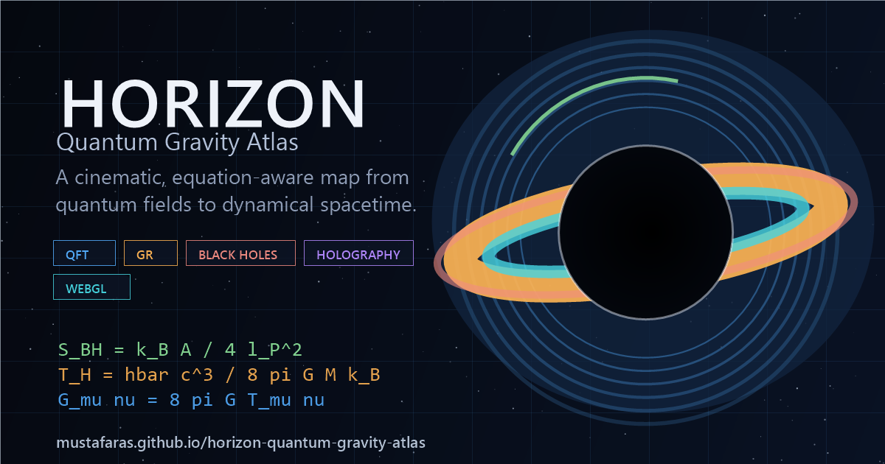

# Development, Quality and Deployment

> Moved from the README in S35: Live Access, Social Preview, Quality Gates, Reproducible sharing, the Screenshot
> Reproduction Guide, Accessibility, Performance, Deployment and Development Notes. Back to the
> [README](../../README.md) · [guide index](README.md).

## Live Access

GitHub Pages:

```text
https://mustafaras.github.io/horizon-quantum-gravity-atlas/
```

Repository-local app:

```text
http://127.0.0.1:8000/
```

The current repository is static-first.

It can run from a plain local HTTP server.

It does not require a backend.

It does not require a build step.

It loads React, Babel, Three.js, KaTeX, and its web fonts from self-hosted copies under `vendor/`, so the atlas has no runtime third-party network dependency.

## Social Preview and Install Metadata

<p align="center">
  
</p>

The repository includes a dedicated Open Graph image for GitHub, LinkedIn, X, Discord, and other social previews.

The app also includes a web manifest and install icons, so browser surfaces can present it as a polished standalone scientific atlas instead of a raw static page.

| Asset | Purpose |
|---|---|
| `docs/social/og-image.png` | 1200x630 social sharing preview |
| `manifest.webmanifest` | install metadata, theme color, app scope, and icon registry |
| `docs/icons/icon-192.png` | Android and PWA launcher icon |
| `docs/icons/icon-512.png` | high-resolution launcher and maskable icon |
| `docs/icons/apple-touch-icon.png` | iOS home-screen icon |
| `docs/icons/favicon-16.png` / `docs/icons/favicon-32.png` | PNG fallbacks for browsers that do not prefer the SVG favicon |

## Quality Gates

The repository includes a lightweight validation suite for the README, metadata, diagrams, screenshots, icons, and social preview assets, plus focused Node tests for the pure physics/reproducibility helpers.

```bash
npm run validate
```

The same check runs in GitHub Actions through `.github/workflows/quality.yml`.

The validation currently enforces:

- no dynamic diagram fences in the README;
- every relative Markdown link and image in `README.md`, `docs/**/*.md` and `paper/**/*.md` resolves to a file (`scripts/lib/link-check.mjs`, S35);
- the README shows every chapter cover in `docs/covers/`;
- the README and the guide together reference at least nine cinematic screenshots, and every static SVG diagram in `docs/diagrams/` is referenced at least once;
- the art-direction rules hold: a 10 px text floor, no blurred text-shadow on figure text, and every canvas 2D context on an allowlist (`scripts/lib/art-direction.mjs`, S36);
- every worker, audio context, observer, listener, animation frame, interval, render target and media stream acquired in `js/` is released (`scripts/audit-render-lifecycle.mjs`, S36);
- the re-measured S03–S28 verification record in `docs/release-verification.md` is current and within the ledger's precision (S36);
- Open Graph and Twitter card metadata exists in the HTML entry file;
- `manifest.webmanifest` is valid JSON and points to real icons;
- PNG assets have the expected dimensions;
- diagram SVG files are structurally complete;
- every asset referenced by `index.html` and by the vendored CSS resolves to a real local file, and no third-party asset is loaded from an external host;
- the exact Three.js version, import-map entries, transitive ESM dependency closure, local file integrity and license agree with the pinned manifests; legacy global assets and external ESM imports are rejected.

This is not a physics test suite.

It is a repository-presentation guardrail that prevents broken academic packaging, missing assets, and GitHub README rendering regressions.

The physics itself is covered separately by `test/physics.test.mjs`, which runs under `node --test` and is executed by the same workflow.

The RG cases cover one-loop QED ultraviolet growth, QCD asymptotic freedom, the $b_0=0$ boundary at $n_f=16.5$, analytic and numerical fixed points, the UV/IR stability convention, deterministic integration and reversal, invalid inputs, and graceful QED/QCD validity termination.

A persistent browser-QA harness lives in `qa/` and runs as a separate GitHub Actions job on pinned Chromium. It is driven by a machine-readable capture manifest (`qa/manifest.json`, validated against `qa/manifest.schema.json`) and covers: clean mounting of all fourteen views with zero console/page errors; URL-state round-trip, reload persistence, back/forward navigation, copy-link, and the versioned export JSON schema; observable differences between reduced and normal motion; keyboard focus, arrow-key sliders, mobile overflow, 44 px touch targets, and horizontal chart scrolling; RG conjectural labeling and preset reset; every GWOSC network phase (success, HTTP error, abort, oversize, cancel) through a deterministic offline fixture; and per-capture visual regression against committed baselines, each with its own justified pixel tolerance. Pull requests and pushes gate only on the critical subset (`npm run qa:critical`: view mounting, ESM runtime, render contracts, plus the native WebGPU boundary check); the full suite runs weekly and on manual dispatch. A single live gwosc.org smoke test exists but runs only on explicit request (`npm run qa:test:live`), never in CI. See [qa/README.md](../../qa/README.md) for the full runbook.

## Reproducible sharing and data modes

The active module, learning pathway, black-hole mass/spin, gravitational-wave controls (mode, event, detector, GPS range, component masses, and the sonification console — audibilization mode, pitch, volume, loop), QFT amplitude-room controls (process, √s, cos θ, Compton x), causal-laboratory controls (preset, β, and both event coordinates), complete RG state, and seed are encoded in the URL query string. Browser back/forward navigation restores those values. Use **Copy link** to share an exact state or **Export JSON** to download a portable state record with a schema version and provenance fields.

Generated visual data uses the recorded seed rather than ambient randomness, so a shared state is reproducible. The gravitational-wave **Signal Analysis Theatre** renders a seeded dual-detector (H1/L1) leading-order chirp with an inspiral–merger–ringdown phase ribbon, a live Hann-windowed STFT spectrogram computed from the displayed samples, and chirp-mass/coalescence-time readouts from the exact leading-order scalings. An animated playback engine sweeps a shared playhead across both instruments — with play/pause, replay, 0.5–4× speed, drag-to-scrub on the progress bar or any trace, a hover crosshair reporting time, strain, and instantaneous frequency, and a merger flash at coalescence — while component-mass sliders (m₁, m₂, URL-encoded as `gwm1`/`gwm2`) reshape the waveform live. Playback is presentation-only: the underlying signals stay seed-deterministic, and animation pauses when the OS requests reduced motion. It also offers a bounded **GWOSC API v2 strain mode** for a named event, detector, GPS range, and 4 kHz text strain product. It caps the compressed and decompressed response, downsamples the calibrated observation for a small browser preview, and shows the event, detector, units, processing, and source links. It times out quickly and falls back to the seeded local waveform when the network, browser decompression, or selected data product is unavailable. The spectrogram is an STFT — not a Q-transform — and the preview's effective sample rate sets its Nyquist limit, which the interface states explicitly.

The theatre's presentation is driven by an explicit state machine — `idle`, `loading`, `real`, `generated`, `error`, `cancelled` — surfaced as a colour-coded status pill with a live dot, the human-readable status sentence, and a contextual **Cancel** (while loading) or **Retry** (after an error or cancellation) action. A superseded or user-cancelled request never overwrites the phase the reader has already moved on to. The shared vertical scale eases toward the new peak whenever the signal changes, so switching seed, mode, or component masses rescales the trace smoothly instead of jumping; the ease is bounded (it stops once settled) and snaps instantly under reduced motion. The observation readout group and the provenance line animate in when real data lands, and the leading edge of the revealed trace carries a mode-coloured glow — blue for the generated teaching signal, cyan for the GWOSC observation — so the two are never visually confusable.

The theatre doubles as a **spacetime instrument**. A sonification console — Web Audio is created only on click, so nothing can ever autoplay — renders the strain audible by mapping the energy-weighted centroid of the 20 Hz–1 kHz analysis band onto A4 = 440 Hz through the audibilization shift; an *original/shifted* toggle with pitch, volume, and loop controls sits beside it, and the console states that this is a frequency-translating rendering (frequencies and perceived duration scale together), the accepted audibilization convention, never a duration-preserving claim. While sound plays, the AudioContext clock drives the visible playhead, and the 3-D spacetime lattice below the strain samples the same signal at each particle's radius — what stretches and squeezes the lattice is the event being heard, in the same frame, rather than two clocks agreeing approximately. The lattice is a WebGPU compute scene (TSL workgroup kernels, particle count tiered by the detail setting) that falls back to a WebGL2 point cloud with identical displacement math where compute is unavailable, and in generated mode the H1 and L1 lattices sit 7 ms of light travel apart. The DSP — zero-phase band-pass with reflection padding, Welch-PSD whitening, antenna patterns, resampling — and the audio graph live in tested pure modules (`js/science/gravitational-waves.mjs`, `js/audio/gw-sonification.mjs`), and the `GENERATED · SEEDED` / `OBSERVATION · GWOSC` labels carry through the audio, the visuals, and the exported metadata.

The **Kerr Black Hole Observatory** animates its equatorial coordinate map rather than redrawing it: horizon, ergosphere, photon-orbit, and ISCO radii interpolate with a cubic ease-out whenever mass or spin changes, the map reports a `settling` state while it moves, and the camera presets ease between viewpoints instead of cutting. A **live formulation** panel prints the governing relations with the current numbers substituted — the horizon pair $r_\pm = M \pm \sqrt{M^2 - a^2}$, the ergosurface $r_E = M + \sqrt{M^2 - a^2\cos^2\theta}$ at both the equator and the pole, the prograde and retrograde photon orbits, the ISCO closed form with its $Z_1$/$Z_2$ intermediates, the surface-gravity ratio, the entropy area law, and the Hawking temperature — each row updating as the sliders move. Printed numbers always come from the exact geometry, never from the eased animation values, and the panel closes with an explicit note separating the exact Kerr coordinate radii from the numerically ray-traced image (display-scaled colour, no enhanced rings). The four self-check limit rows and the live state line are typeset with KaTeX too, so the limit labels and the substituted numbers render as real mathematics rather than Unicode approximations.

The official API source used is https://gwosc.org/api/, with v2 documentation and schema at https://gwosc.org/api/v2/docs (schema: `/api/v2/schema`).

The QFT **Amplitude Room** is a live 2 → 2 scattering bench. It evaluates the Mandelstam variables from the four-momenta, the angular differential cross-section split into its channels, and the tree-level γ + Z cross-section and forward-backward asymmetry from 10 to 200 GeV beside the LEP Z-pole values on every frame, using the pure functions in `js/science/electroweak.mjs` and `js/physics.mjs`. Five processes are offered: e⁺e⁻ → μ⁺μ⁻ through a photon and a Z (photon, Z and interference terms), Bhabha e⁺e⁻ → e⁺e⁻ (s channel, t channel and interference), Møller e⁻e⁻ → e⁻e⁻ (t, u and interference), e⁻μ⁻ → e⁻μ⁻ (the complete massless t-channel result) and Compton γe⁻ → γe⁻ (Klein–Nishina). The Feynman builder above it draws every tree diagram of the process (both channels for Bhabha, Møller and Compton) with the geometry of `js/visualizations/qft/feynman-svg.mjs`. The transport bar scrubs a normalised collision phase τ ∈ [0, 1] with play/pause, replay, and 0.5–4× speed; the animation is presentation only and the readouts do not depend on it. Playback is disabled when the OS requests reduced motion. Each of the four instrument panels carries a titled header bar, and the transport strip reports the live collision phase (incoming / interaction / outgoing) next to the clock, so the schematic canvases are always labelled as schematic. The scan is tree level: no initial-state radiation, no loop corrections, a fixed α and a constant Z width; the LEP points are Z-pole pseudo-observables compared with the line only at the pole. The Compton slider x = E_γ/mₑc² is a lab-frame ratio and is deliberately decoupled from √s. The Mandelstam and observable readout captions are typeset with KaTeX, so the defining relation under each number is real mathematics rather than a Unicode approximation.

The GR **Causal Spacetime Laboratory** is an exact 1+1D special-relativistic instrument using diagram units `c = 1 light-second per second` and metric signature `(−,+,+,+)`. It evaluates `Δs² = −(Δct)² + Δx²`, `γ`, the Lorentz-transformed event pair, causal-order verdicts, simultaneity-frame β, and timelike proper time from the pure helpers in `js/physics.mjs` and the browser mirror in `js/physics.jsx`. Five documented presets cover timelike, spacelike, null, relativity-of-simultaneity, and twin-style piecewise-inertial examples. The twin path uses two inertial legs and an explicitly schematic instantaneous turnaround; it does not model acceleration. Exact readouts always use the target β, while eased boosted axes and A′/B′ ghosts are presentation only. URL keys `grp`, `grb`, `grat`, `grax`, `grbt`, and `grbx` restore the preset, frame, and two events. β is restricted to `[-0.95, 0.95]`, coordinates to `[-4, 4]`, and invalid or out-of-range URL values fall back to the documented defaults. JSON export records the flat-spacetime model, established-special-relativity status, dimensionality, conventions, scope, implementation files, and standard references. The interval-classification, residual, and β-bound captions in the readout deck are typeset with KaTeX, with the interval sign built from the live computed value.

The **RG Flow Landscape** records preset (`rgp`), originating preset (`rgpo`), model (`rgm`), initial coupling (`rgg`), reference scale (`rgmu`), logarithmic bounds (`rglo`, `rghi`), flavour count (`rgnf`), toy coefficients (`rga`, `rgb`, `rggs`), and current scale (`rgc`). Editing any control sets `rgp=custom` while `rgpo` retains the preset being edited, so **Reset preset** returns to that preset rather than an unrelated default; when `rgpo` is absent or incompatible with the model it is derived deterministically, keeping older links valid. Scientific status follows the active model and originating preset rather than the literal preset, so a customised toy flow keeps its conjectural badge and caveat. Ranges are validated on load; incompatible preset/model pairs resolve to the documented preset model, QED is clamped to `rgnf >= 1`, and invalid narrow ranges revert to the QCD defaults. Back/forward restores the complete instrument. The export adds the β convention, model parameters, fixed points, RK4 method and step, numerical/root tolerances, IR and UV termination status, validity disclosures, implementation provenance, and standard references.

Curve morphing lasts a bounded 520 ms and then writes the exact target geometry. The flow tracer and current-point pulse each run once. Under `prefers-reduced-motion: reduce`, the trajectory snaps directly to the final points and all decorative motion remains static; no scientific state or control depends on animation.

## Screenshot Reproduction Guide

Every screenshot is reproducible from the committed capture manifest. The manifest (`qa/manifest.json`) pins, per capture: the exact URL state, viewport and device scale factor, motion mode, measurable readiness probes (no fixed sleeps), the screenshot scope (viewport, full page, or a named element), the deterministic GWOSC fixture where used, and the visual-regression tolerance with its justification. The capture CLI serves **this checkout** on a loopback-only server, verifies byte-equality between the served page and the file on disk, and renders with pinned Chromium:

```bash
npm run qa:capture            # all captures -> qa/output/ (scratch)
npm run qa:capture -- --docs  # also refresh docs/screenshots/ below
npm run qa:verify             # validate the manifest against schema + the README and this guide
```

The screenshot set emphasizes visual and animated modules:

| File | Target view | Main visual purpose |
|---|---|---|
| `01-black-hole-kerr-raymarch.png` | `bh` | black-hole raymarching, horizon, disk lensing |
| `02-holographic-boundary-bulk.png` | `bh` | boundary-bulk holography |
| `03-qft-feynman-collision.png` | `qft` | scattering event and Feynman diagram |
| `04-planck-scale-foam.png` | `planck` | scale descent and speculative Planck grid |
| `05-spacetime-curvature-lensing.png` | `gr` | geodesics and curvature |
| `06-collider-event-display.png` | `exp` | collider tracks and detector geometry |
| `07-gravitational-wave-inspiral.png` | `exp` | binary inspiral and gravitational waves |
| `08-theory-constellation.png` | `approaches` | quantum-gravity program map |
| `09-mobile-black-hole-lab.png` | `bh` | responsive black-hole module |
| `10-kerr-observatory-layers.png` | `bh` | Kerr observatory with exact-coordinate radii map |
| `11-kerr-observatory-mobile.png` | `bh` | mobile Kerr observatory, collapsible map |
| `12-gw-theatre.png` | `exp` | GW analysis theatre mid-playback: dual strain, playhead, STFT + chirp track, transport |
| `12b-gw-theatre-real.png` | `exp` | GWOSC real-observation mode with provenance |
| `13-gw-theatre-mobile.png` | `exp` | mobile GW theatre, stacked instrument panels |
| `14-qft-amplitude-room.png` | `qft` | amplitude room: scattering plane, interference waterfall, angular plot by channel, γ + Z energy scan |
| `15-qft-amplitude-room-mobile.png` | `qft` | mobile amplitude room, single-column instrument stack |
| `16-causal-spacetime-lab.png` | `gr` | causal laboratory at `?view=gr&grp=simultaneity&grb=0.4&grat=-0.8&grax=-2.4&grbt=0.8&grbx=1.6`, 1440 × 1200 |
| `17-causal-spacetime-lab-mobile.png` | `gr` | null-separation causal laboratory at `?view=gr&grp=null&grb=-0.55&grat=-2&grax=-2&grbt=2&grbx=2`, 390 × 844 |
| `18-rg-flow-landscape.png` | `rg` | QCD preset at `?view=rg&rgp=qcd`, 1440 × 1200 |
| `19-rg-flow-landscape-mobile.png` | `rg` | pedagogical toy at `?view=rg&rgp=asymptotic-safety&rgm=asymptotic-safety&rgg=0.3&rgmu=0&rglo=-4&rghi=5&rgnf=0&rga=0.9&rgb=0.9&rgc=4`, 390 × 844 |
| `44-rg-gravity-flow.png` | `rg` | Einstein–Hilbert flow silk, trajectory figure, readouts and scheme table at `?view=rg&seed=42`, 1440 × 2500 |
| `45-rg-gravity-flow-mobile.png` | `rg` | the same lab in one column at `?view=rg&seed=42`, 390 × 3200 |
| `25-ads-bulk-boundary-lab.png` | `approaches` | AdS holography lab at `?view=approaches&aln=5&alr=0.5`: exact geodesics, RT surface, entanglement wedge |
| `26-collider-event-lab.png` | `sm` | synthetic collider lab at `?view=sm&clc=h2gg&seed=42`: tracks, towers, jets, missing energy |
| `27-spin-foam-lab.png` | `planck` | spin-foam lab at `?view=planck&sfj=2&sfm=network`: four-simplex network, spin-coloured edges, and the computed area and volume spectra beside it |
| `28-qft-field-lab.png` | `qft` | field laboratory at `?view=qft&seed=42`: a classical φ⁴ field on a GPU lattice drawn by its energy density, with the Hamiltonian-density card |
| `51-planck-constraint-plane.png` | `planck` | "The map of the unseen" at `?view=planck&seed=42`: eleven sourced limits and observed scales on a logarithmic length–energy plane, with the Planck corner and the selected entry's citation |

Capture criteria:

- screenshot must come from a real running app state;
- screenshot must show a scientific visualization, not only text;
- black-hole screenshots must remain prominent;
- conjectural scenes must remain labeled;
- the README must not imply observational confirmation where none exists.

## Accessibility and Responsiveness

The application includes:

- keyboard-aware 3D controls;
- reduced-motion support;
- ARIA labels on interactive scenes;
- 2D fallbacks for WebGL failure;
- status labels that do not rely only on color;
- responsive navigation for narrow screens;
- a skip link as the first focusable element, so keyboard users bypass the sidebar instead of tabbing through it on every view;
- a section outline on every view: exactly one `h1`, no skipped heading levels, and a non-empty accessible name on every interactive control;
- WCAG 2.2 AA text contrast (4.5:1 body, 3:1 large) verified across all views.

The last four are enforced by `qa/specs/a11y.spec.mjs`, which measures contrast by resolving computed colours through a canvas and compositing every ancestor background bottom-up — a single-layer read un-premultiplies translucent overlays into false failures.

The mobile black-hole screenshot documents that the visual module remains accessible on smaller viewports.

## Performance Notes

The app is static, but the visual scenes are nontrivial.

The black-hole module uses a shader-based lensing approximation.

The QFT and GR modules use Three.js scene construction.

The Planck and experiment modules animate grids, particles, or detector structures.

Performance-sensitive users can adjust:

- visualization mode;
- motion level;
- 3D detail level;
- label visibility;
- annotation visibility;
- ambient starfield.

These controls are available through the in-app tweaks panel.

## Deployment

The project can be hosted on any static site host.

GitHub Pages is sufficient.

Suggested GitHub Pages configuration:

1. Push the repository to GitHub.
2. Open repository **Settings**.
3. Open **Pages**.
4. Select **Deploy from a branch**.
5. Choose the `main` branch.
6. Choose the repository root.
7. GitHub Pages will serve `index.html`.

No server rewrite rules are required.

No database is required.

No environment variables are required.

The deployed app includes:

- canonical URL metadata;
- Open Graph and Twitter large-card metadata;
- a 1200x630 social preview image;
- SVG and PNG favicon paths;
- Apple touch icon metadata;
- install metadata through `manifest.webmanifest`.

## Development Notes

The codebase intentionally avoids build-system complexity.

That makes the project easy to inspect.

It also means browser loading order matters.

The module scripts are declared from `index.html`.

The app shell expects module constructors to be assigned to `window`.

The shared helpers are attached globally from `core.jsx`, `scene3d.jsx`, and `data.jsx`.

This pattern favors educational transparency over modern bundler ergonomics.
