# Visual Atlas

> Moved from the README in S35, with the Static Diagram Pack. The README keeps one cover per chapter; the full
> gallery lives here. Back to the [README](../../README.md) · [guide index](README.md).

All screenshots below were captured from the running application, not from static mockups.

The screenshot set intentionally functions as a cinematic gallery: each frame should show a scientific visualization, an active module state, and a meaningful physical interpretation.

Black-hole screenshots are included prominently because the black-hole module is the strongest visual bridge between general relativity, quantum field theory, thermodynamics, entropy, and holography.

<table>
<tr>
<td width="50%">
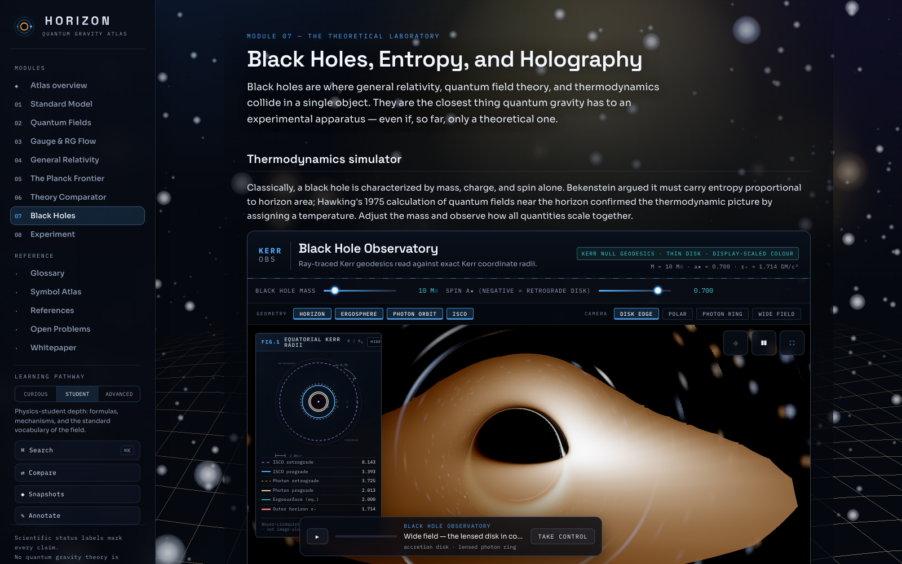
 
<strong>Black-hole Kerr laboratory</strong> — ray-traced Kerr accretion disk with Doppler beaming and gravitational redshift, higher-order images, lensed stars, horizon readouts, entropy and temperature scaling.
</td>
<td width="50%">
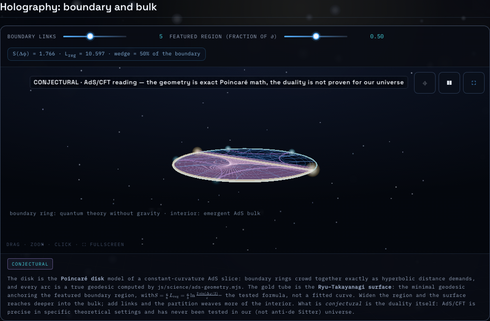
 
<strong>Holography: boundary and bulk</strong> — 3-D Poincaré disk with exact hyperbolic geodesics, the Ryu–Takayanagi minimal surface and its entanglement wedge; the duality reading is conjectural.
</td>
</tr>
<tr>
<td width="50%">
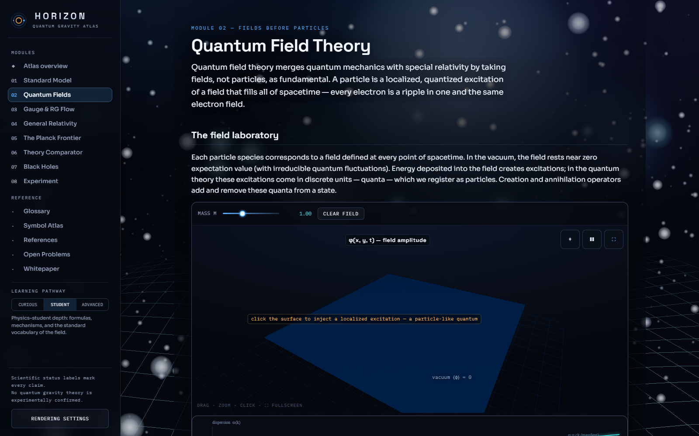
 
<strong>QFT collision laboratory</strong> — animated scattering process with exchanged virtual carrier and matching Feynman diagram.
</td>
<td width="50%">
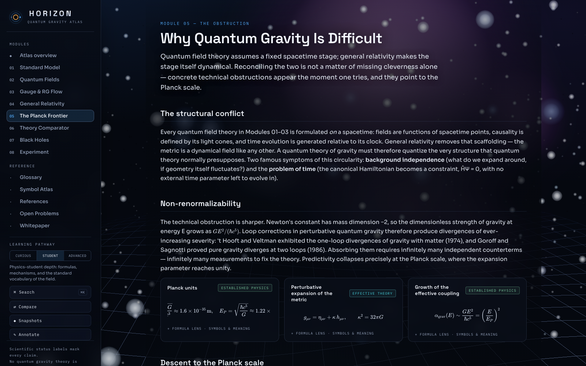
 
<strong>Planck frontier</strong> — logarithmic descent from human scale to the speculative Planck regime and the experimental desert.
</td>
</tr>
<tr>
<td width="50%">
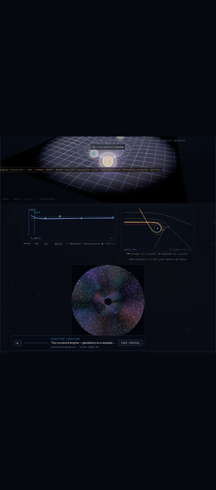
 
<strong>Curvature engine</strong> — deformable spacetime slice, geodesic motion, perihelion advance, and gravitational lensing rays.
</td>
<td width="50%">
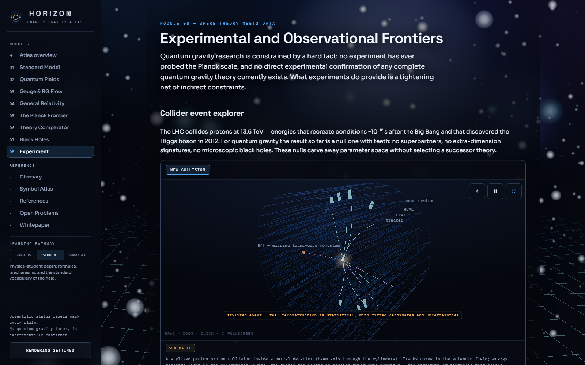
 
<strong>Collider event display</strong> — stylized detector barrel, charged tracks, calorimeter deposits, and missing transverse momentum.
</td>
</tr>
<tr>
<td width="50%">
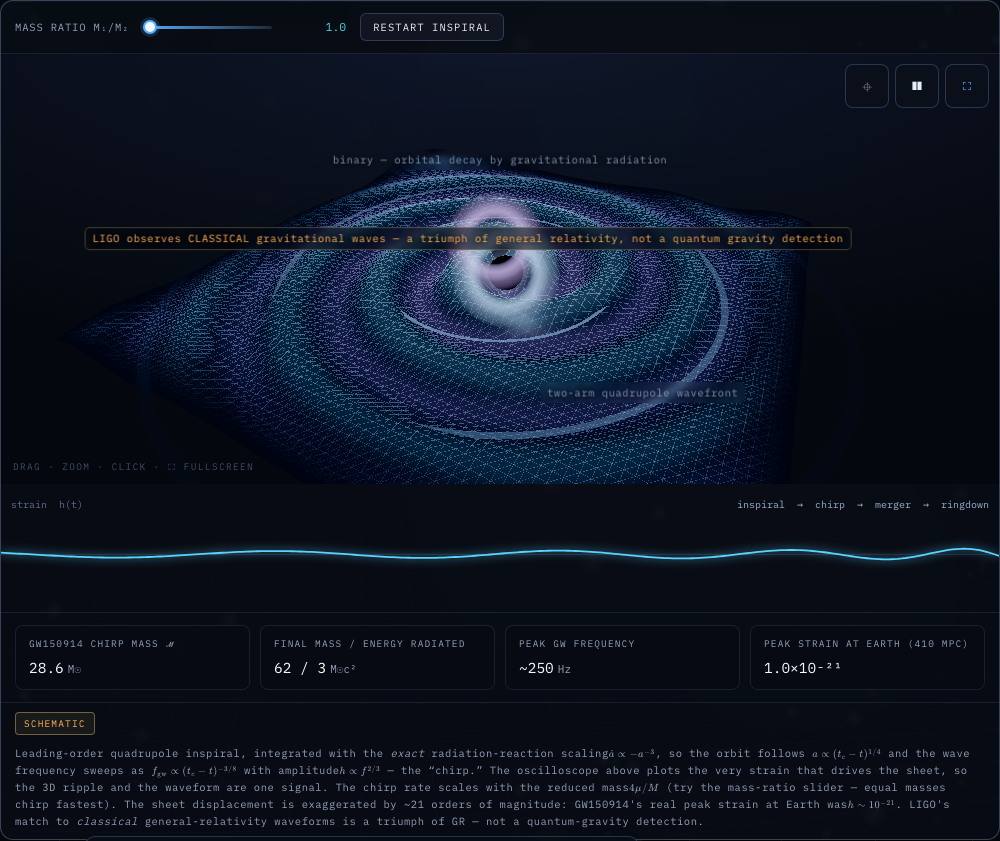
 
<strong>Gravitational waves</strong> — binary inspiral, orbital decay, spacetime ripple, and strain interpretation.
</td>
<td width="50%">
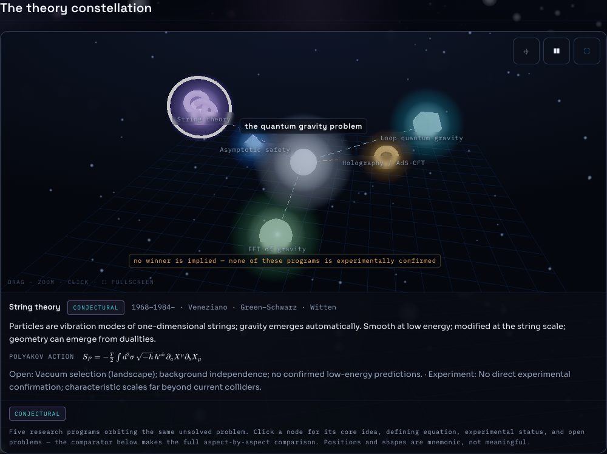
 
<strong>Theory constellation</strong> — string theory, loop quantum gravity, asymptotic safety, EFT gravity, and holography orbiting the same unresolved problem.
</td>
</tr>
<tr>
<td width="50%">
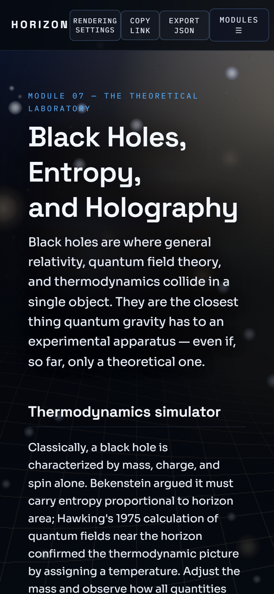
 
<strong>Mobile black-hole laboratory</strong> — responsive module layout with the black-hole scene preserved on a narrow viewport.
</td>
<td width="50%">
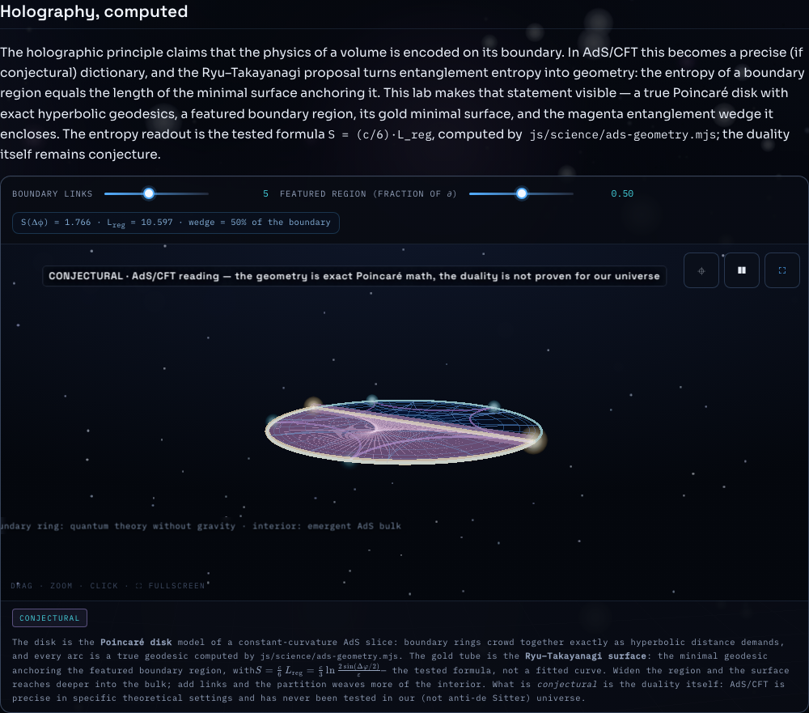
 
<strong>AdS holography laboratory</strong> — exact hyperbolic geodesics, boundary partition arcs, the Ryu–Takayanagi minimal surface and its entanglement wedge, computed from the tested geometry module.
</td>
</tr>
<tr>
<td width="50%">
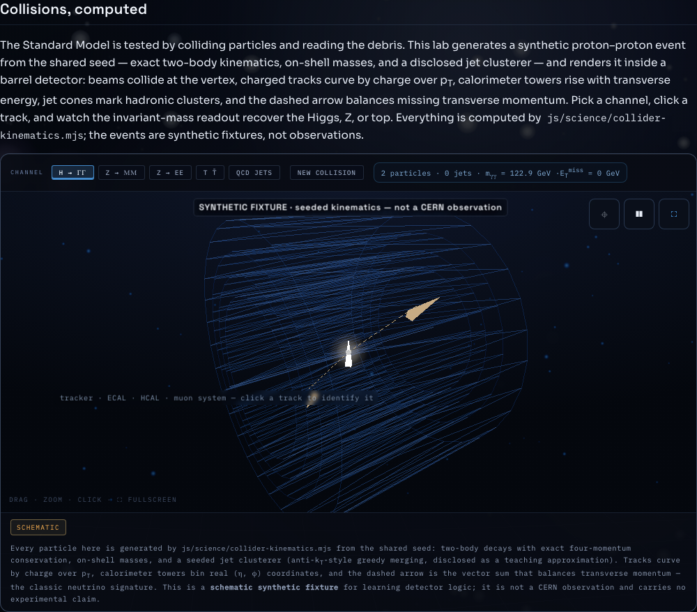
 
<strong>Collider event laboratory</strong> — seeded synthetic pp collision in a barrel detector: curved tracks, calorimeter towers, jet cones and missing transverse energy; a fixture, never an observation.
</td>
<td width="50%">
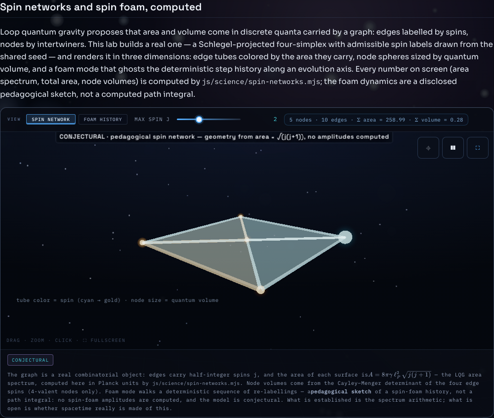
 
<strong>Spin-foam laboratory</strong> — Schlegel-projected four-simplex spin network with spin-coloured edges, volume-weighted nodes and translucent face membranes, above the computed area and volume spectra of the loop-quantum-gravity operators; pedagogical, conjectural.
</td>
</tr>
<tr>
<td width="50%">
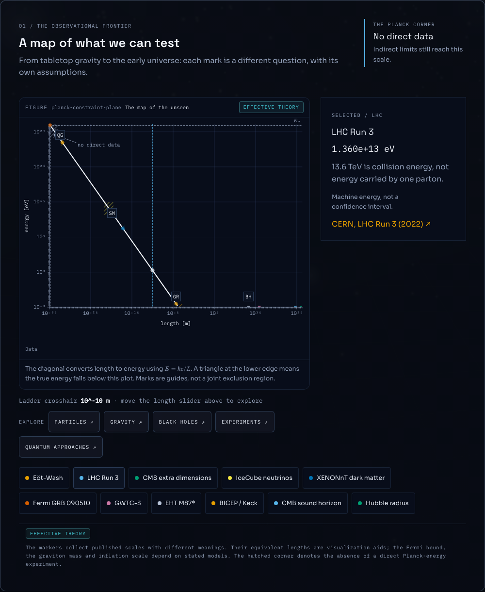
 
<strong>The map of the unseen</strong> — every published limit and observed scale in one logarithmic plane, with <code>E = ħc/L</code> as the diagonal: Eöt-Wash, the LHC and CMS, IceCube, XENONnT, Fermi, GWTC-3, the Event Horizon Telescope, BICEP/Keck, the CMB sound horizon and the Hubble radius. Each carries its value, confidence level, uncertainty and a primary-source link, and the hatched Planck corner marks where no direct data exist. See <a href="../render/planck-constraints.md">docs/render/planck-constraints.md</a>.
</td>
<td width="50%">
<strong>Screenshot policy</strong>
  
Every visual in this guide must be reproducible from a real app state.
  
No stock imagery.
  
No decorative-only hero art.
  
No screenshot should imply that conjectural physics is experimentally observed.
</td>
</tr>
<tr>
<td width="50%">
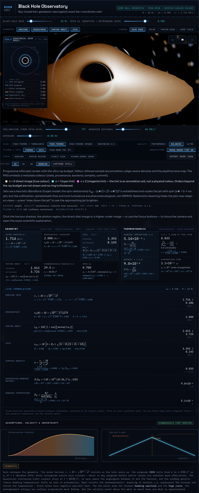
 
<strong>Kerr geometry observatory</strong> — live high-spin view with horizon, equatorial ergosphere, prograde/retrograde photon-orbit and ISCO layers. The map uses exact Kerr coordinate radii; the image beside it integrates Carter's Kerr geodesics per pixel (WebGPU compute or WebGL2), with display-scaled colour — see <a href="../science/kerr-observatory.md">docs/science/kerr-observatory.md</a>.
</td>
<td width="50%">
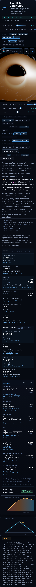
 
<strong>Mobile geometry instrument</strong> — the exact-coordinate radii map starts collapsed on small screens and remains available from a compact in-scene control, preserving the lensing view without discarding scientific context.
</td>
</tr>
<tr>
<td width="50%">
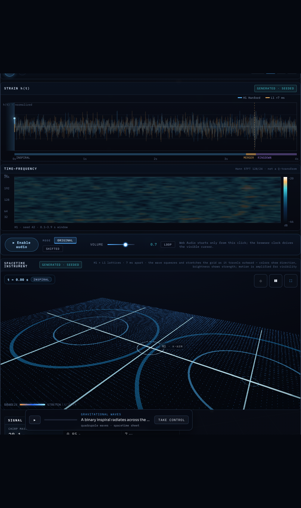
 
<strong>GW signal analysis theatre</strong> — seeded dual-detector chirp with animated playback: a transport bar (play/pause, replay, 0.5–4× speed) sweeps a playhead across both instruments, the strain reveals progressively with a merger flash at coalescence, and the Hann-STFT spectrogram overlays the exact leading-order frequency track. Drag the playhead or any trace to scrub; hover for a live t·h·f crosshair readout; component masses and seed are slider-controlled and URL-encoded.
</td>
<td width="50%">
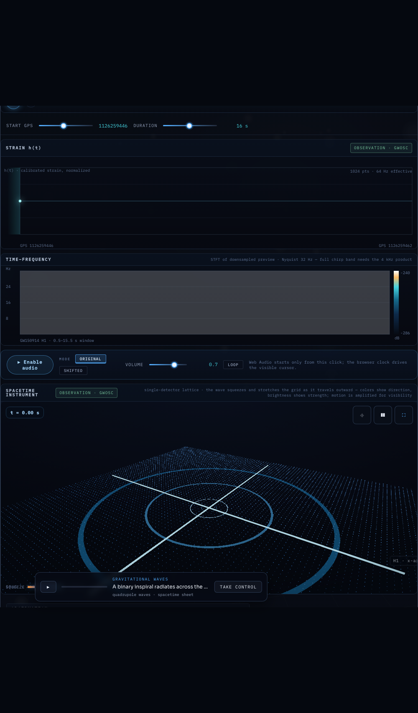
 
<strong>Real observation mode</strong> — bounded GWOSC API v2 calibrated strain (GW150914·H1 preview) with GPS axis, provenance links, and an explicit effective-rate Nyquist limit for the downsampled preview.
</td>
</tr>
<tr>
<td width="50%">

 
<strong>Mobile analysis theatre</strong> — transport, strain, and time–frequency panels stack without horizontal overflow; playback, scrubbing, and the seeded simulation remain fully usable offline.
</td>
<td width="50%">
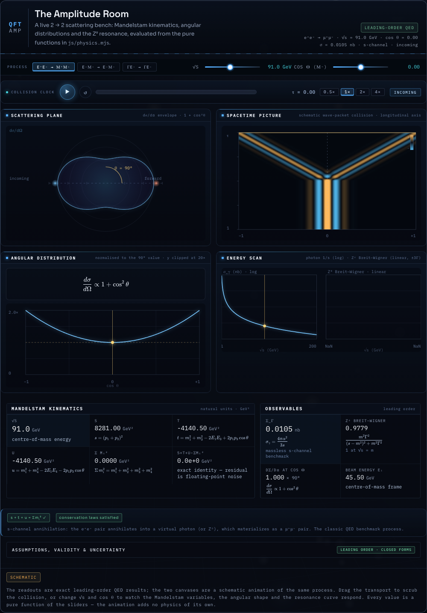
 
<strong>QFT amplitude room</strong> — a live 2 → 2 scattering bench. The Mandelstam variables, the angular distribution, the photon 1/s cross-section, and the Z⁰ Breit–Wigner shape are evaluated from the pure physics functions on every frame; the transport bar scrubs a normalised collision phase, and the identity residual is shown rather than hidden.
</td>
</tr>
<tr>
<td width="50%">
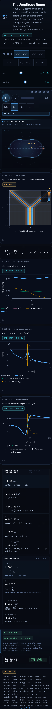
 
<strong>Mobile amplitude room</strong> — the four instrument panels stack into a single column and the control rows expand to full width, with no horizontal overflow.
</td>
<td width="50%">
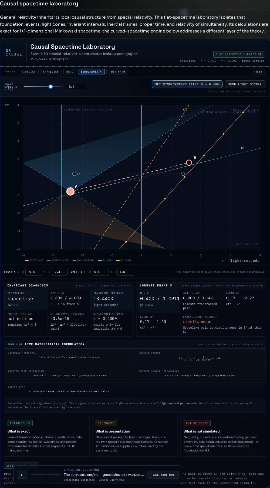
 
<strong>Causal Spacetime Laboratory</strong> — exact 1+1D Minkowski calculations drive the interval classification, transformed coordinates, proper-time readouts, and substituted Lorentz equations. Eased axes and event ghosts are presentation only.
</td>
</tr>
<tr>
<td width="50%">
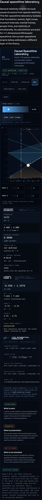
 
<strong>Mobile causal laboratory</strong> — presets and frame controls retain 44 px touch targets; the wide scientific diagram scrolls inside its own container without widening the page.
</td>
<td width="50%">
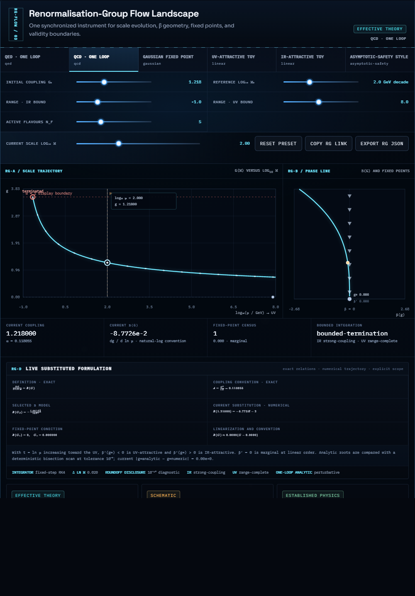
 
<strong>RG Flow Landscape</strong> — the scale trajectory and β-function phase line share a coupling axis. The QCD preset exposes asymptotic freedom, the infrared strong-coupling boundary, fixed-point classification, and deterministic RK4 diagnostics without presenting the invalid region as a successful continuation.
</td>
</tr>
<tr>
<td width="50%">

 
<strong>Mobile RG instrument</strong> — documented presets and controls retain 44 px targets; the wide scale graph scrolls inside its panel, while the polynomial preset is labelled a pedagogical toy and the computed asymptotic-safety lab sits below it as a separate, conjectural figure.
</td>
<td width="50%">
<strong>RG screenshot state</strong>
  
Desktop: one-loop QCD with five active flavours.
  
Mobile: the pedagogical polynomial toy (the old "asymptotic-safety style" preset, same id).
  
The paired captures deliberately keep perturbative and conjectural layers visually and textually distinct.
</td>
</tr>
<tr>
<td width="50%" colspan="2">
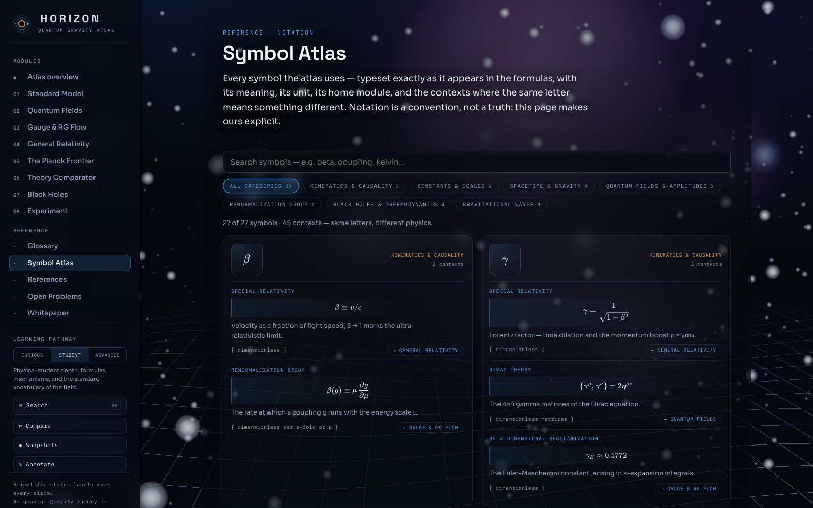
 
<strong>Symbol Atlas</strong> — a dedicated notation reference: every symbol with its unit, its home module, and the contexts where the same letter means different physics (β = v/c vs β(g); the metric g_μν vs a coupling g vs a fixed point g★). Every glyph and defining equation is typeset live with KaTeX, category filters carry per-context counts, full-text search and deep links into the owning modules are built in, and the atlas' metric-signature and natural-unit conventions are stated explicitly.
</td>
</tr>
<tr>
<td width="50%" colspan="2">
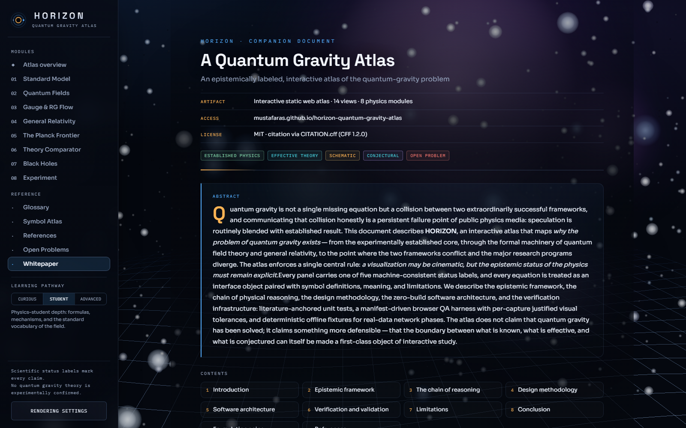
 
<strong>Whitepaper</strong> (<code>?view=paper</code>) — the companion document as a first-class tab rather than an external file: abstract, the five-status epistemic table, the chain of reasoning from established physics to the open problem, the design and verification methodology, and a <em>formulation spine</em> of the equations the atlas actually implements. Every equation is typeset live with KaTeX and paired with a symbol table, its meaning, and its stated limits; the section index jumps directly to any part of the document.
</td>
</tr>
</table>

## Static Diagram Pack

### Quantum Gravity Problem Stack

  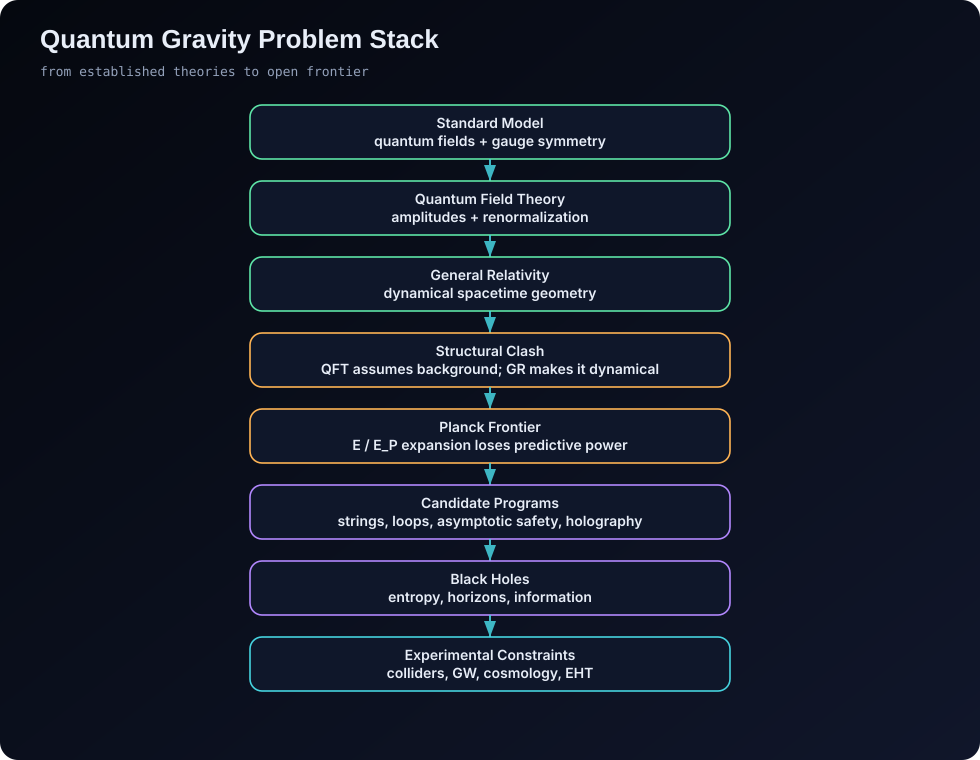

### Black-Hole Information Flow

  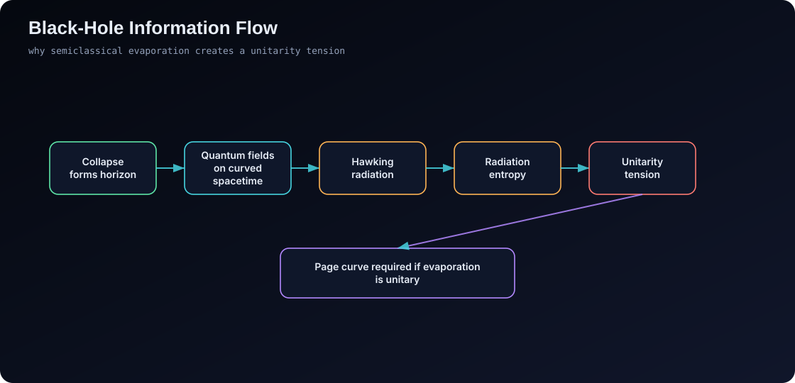

### Renderer Pipeline

  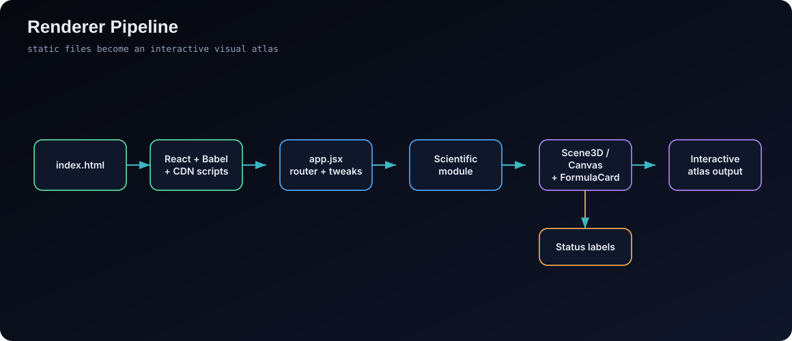

### Theory Comparator Map

  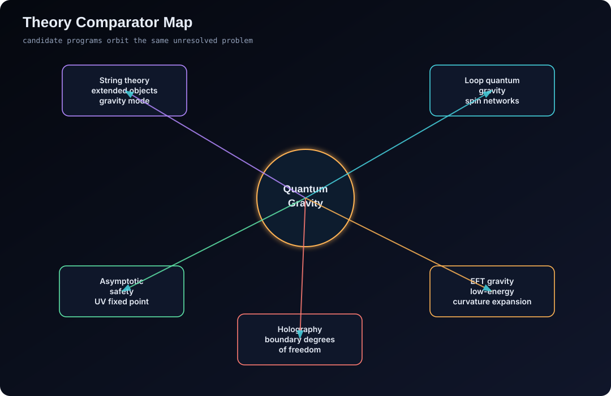

### Screenshot Reproducibility Flow

  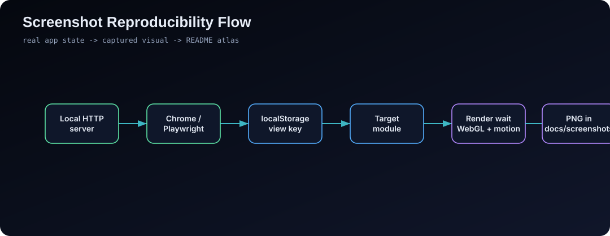

